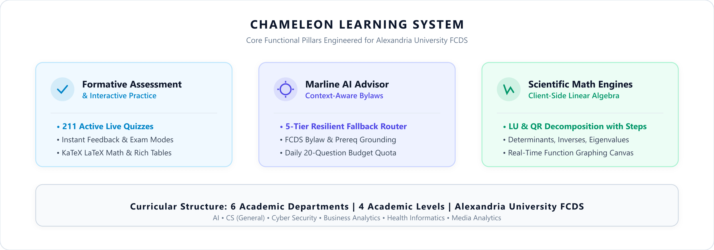
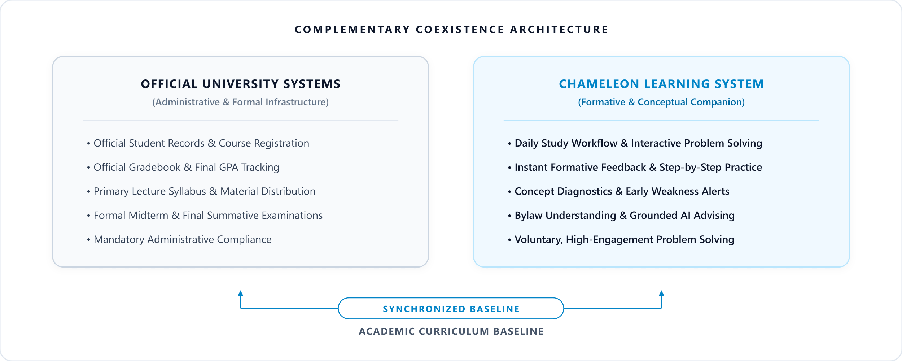
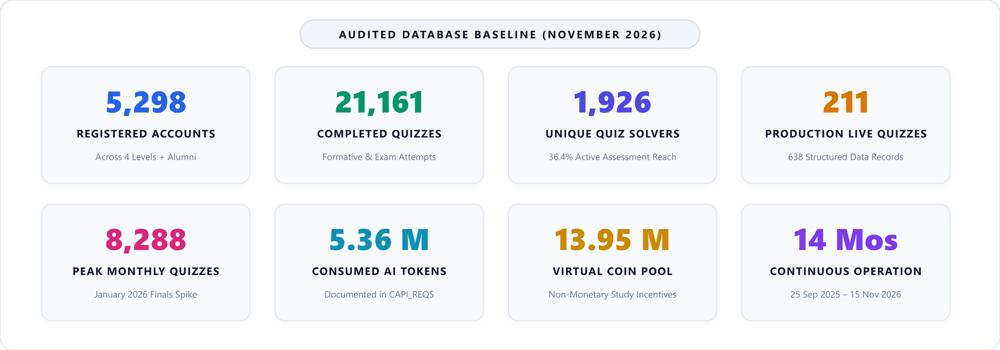
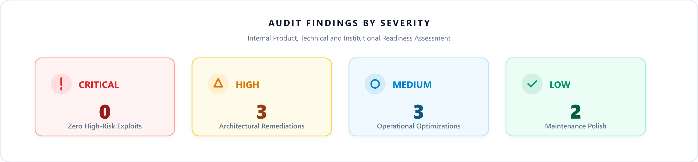

# CHAMELEON PLATFORM — EXECUTIVE BRIEF
**Document Type:** Internal Product, Technical and Institutional Readiness Assessment  
**Author / Presenter:** Project Ownership & Technical Maintenance Team  
**Target Audience:** Faculty Dean, Vice Deans, Department Heads, and Steering Committee  
**Institution:** Faculty of Computer and Data Science (FCDS), Alexandria University  
**Audit Period:** 15 November 2026 | **Reading Time:** ~5 Minutes  

---

## 1. Context & Purpose of this Brief

This document summarizes an **internal product, technical, and institutional readiness assessment** conducted by the project maintainers of the **Chameleon** platform in 15 November 2026. The objective is to present verified empirical data from 14 months of continuous operation (since 25 September 2025) and propose a structured, low-risk collaboration framework with the Faculty of Computer and Data Science (FCDS) at Alexandria University.

Chameleon was developed specifically to address the daily learning, problem-solving, and curriculum-navigation challenges of FCDS students.

---

## 2. Platform Overview: What Chameleon Is (and Is Not)

Chameleon is a digital academic companion and formative assessment platform tailored to Alexandria University FCDS credit-hour degree programs.



```
┌────────────────────────────────────────────────────────────────────────────────────────┐
│                               CHAMELEON PLATFORM SCOPE                                 │
│                                                                                        │
│   [ Formative Assessment Engine ] ──> 211 active quizzes, instant feedback & LaTeX     │
│   [ Marline AI Academic Advisor ] ──> Bylaw-context-aware assistant (5-tier fallback)  │
│   [ Mathematical & Matrix Tools ] ──> Client-side LU/QR decomposition & function graph │
│   [ Virtual Motivation Economy  ] ──> Non-monetary badges & themes for problem-solving │
│   [ Curricular Structure        ] ──> Mapped across 6 departments and 4 levels         │
└────────────────────────────────────────────────────────────────────────────────────────┘
```

### Critical Scope Boundaries:
- **It is NOT an administrative Learning Management System (LMS):** It does not manage official university gradebooks, lecture attendance, or formal accredited exams.
- **It is NOT a replacement for university infrastructure or faculty:** It serves as a complementary formative practice and advising layer.
- **It is NOT an unconstrained commercial chatbot:** Marline retrieves official credit-hour regulations, course codes (`02-24-00101` through Level 4 electives), and prerequisites, though its outputs remain advisory and require verification.

---

## 3. Complementary Positioning: Enhancing the Learning Experience



Chameleon is designed to operate alongside Alexandria University's existing educational infrastructure:
- **Official University Systems:** Provide formal course registration, official lecture syllabus distribution, and summative assessments (Midterm and Final exams).
- **Chameleon Formative Companion:** Provides daily self-paced problem solving, instant step-by-step rationales, diagnostic feedback before examinations, and 24/7 bylaw navigation.

Chameleon activates student engagement between lectures, giving students an interactive environment to test their comprehension voluntarily.

---

## 4. Audited Database Metrics (Empirical Evidence)



A direct, read-only inspection of the production PostgreSQL database in 15 November 2026 verified the following operational metrics:

| Metric Category | Audited Database Record | Institutional Context & Caveats |
|---|---|---|
| **Registered User Accounts** | **5,298 registered accounts** | Database records in `chameleons`. Represents accounts created since 25 September 2025; cross-referencing with registrar records is required to determine exact current enrollment deduplication. |
| **Cohort Distribution** | **Freshmen (L1):** 681 (13.6%)<br>**Sophomores (L2):** 1,617 (32.3%)<br>**Juniors (L3):** 1,631 (32.5%)<br>**Seniors (L4):** 857 (17.1%)<br>**Alumni / TAs / Other:** 227 (4.5%) | Accurately categorized by academic level. Students in Sophomores, Juniors, and Seniors represent **81.9%** of all registered accounts. |
| **All-Time Completed Quizzes** | **21,161 completed attempts** | Direct row count in `quiz_data` (submission sequence counter reached 30,285). Reflects substantial voluntary problem-solving activity. |
| **Unique Assessed Students** | **1,926 unique students** | Paginated extraction of distinct `auth_id`s in `quiz_data`. **36.4% of total registered accounts** have actively completed at least one quiz. |
| **Examination Seasonality** | **Jan 2026:** 8,288 quiz attempts<br>**Nov 2025:** 5,497 quiz attempts<br>**Dec 2025:** 4,001 quiz attempts | Verifies acute usage spikes during university midterm and final exam windows. General website visits (DAU/MAU) are unmeasured by dedicated analytics. |
| **Assessment Library** | **211 live quizzes** (Production DB)<br>**638 pre-structured units** (Seed data) | 16,948 categorized questions across 66 course subjects covering all 6 FCDS departments. |
| **AI Academic Assistance** | **3,102,524 tokens logged** | Recorded in `CAPI_REQS` across 141 tracked accounts under a daily quota of 20 questions/day. |

---

## 5. Financial Reality: Documented vs. Estimated Expenses

The platform operates on a lean serverless architecture. Financial requirements are divided into three transparent classifications:

1. **Documented Actual Expenses (Current Out-of-Pocket):**
   - Supabase Pro Database: \$25.00 / month (~1,225 EGP)
   - Vercel Pro Hosting: \$20.00 / month (~980 EGP)
   - Domain Registration: ~\$1.25 / month (\$15/year / ~60 EGP)
   - AI APIs: Currently utilizing developer and free tiers (~0–\$15/mo).
   - **Current Base Infrastructure Total:** **~\$46.25 to \$61.25 / month (~2,260 to 3,000 EGP / month)**.

2. **Estimated Future Operating Expenses for Institutional Pilot:**
   - Base Infrastructure (Supabase + Vercel + Domain): ~\$46.25 / month
   - Upstash Distributed Redis (Rate limiting & brute-force protection): ~\$15.00 / month (~735 EGP)
   - Commercial Paid AI API Quotas (Guaranteed availability): ~\$40.00 / month (~1,960 EGP)
   - Application Error Monitoring (Sentry Team): ~\$15.00 / month (~735 EGP)
   - **Estimated Production Pilot Infrastructure Total:** **~\$100 to \$150 / month (~4,900 to 7,350 EGP / month)**.

3. **Proposed Engineering & Maintenance Compensation (Separate Classification):**
   - Modest part-time stipend for student engineering maintainers (optional): ~\$250 to \$350 / month (~12,250 to 17,150 EGP).
   - *Presented strictly as an optional administrative consideration, entirely distinct from hard hosting expenses.*

---

## 6. Proposed Data Governance & Intellectual Property Framework

To ensure institutional compliance and protect student privacy:
- **Data Governance:** In consultation with qualified university legal counsel, establish a formal agreement defining the Faculty as the Data Controller and the platform maintainers as Data Processors under Egyptian Personal Data Protection Law No. 151 of 2020.
- **Data Ownership:** Alexandria University retains exclusive ownership of all student academic data, assessment records, and platform telemetry.
- **Intellectual Property:** The founder/maintainers retain underlying software copyright while granting Alexandria University FCDS an institutional, non-exclusive educational operating license for the duration of the partnership.
- **Privacy Protections:** Student academic records are isolated, encrypted in transit (HTTPS/TLS) and at rest, and never shared with commercial advertisers.

---

## 7. Limitations & Items Requiring Institutional Verification



To maintain complete credibility, the following limitations are explicitly noted:
1. **Enrollment Cross-Referencing:** Account figures (5,298) reflect database registrations; official active enrollment deduplication requires registrar validation.
2. **Web Analytics Tracking:** Platform-wide daily and monthly active users (DAU/MAU) are not tracked; quiz completion is the only empirical timestamped event log.
3. **AI Advising Boundary:** Marline is context-aware via structured bylaw retrieval, but outputs are advisory and require human verification.
4. **Historical Uptime:** No third-party synthetic monitoring was active; uptime has relied on standard Vercel and Supabase availability.

---

## 8. Reframed Institutional Request: A Phased Approach

Rather than requesting full institutional commitment immediately, the project team proposes a **measured, five-step pathway**:

```
Step 1: Institutional Review ──> Presentation of assessment findings to Faculty Leadership.
Step 2: Technical/Academic Eval ─> Joint review of question banks and architecture by designated faculty.
Step 3: Limited 4-Course Pilot ──> Low-stakes, 15-week Spring 2027 pilot across 4 foundation courses.
Step 4: Joint Evaluation ────────> Analysis of student engagement, feedback surveys, and system stability.
Step 5: Partnership & Support ───> Discussion of formal recognition, long-term hosting, and integration.
```

### Proposed Spring 2027 Pilot Scope:
- **Courses:** *Linear Algebra* (L1), *Programming I/II* (L1), *Data Structures & Algorithms* (L1/L2), *Database Systems* (L2).
- **Core KPIs:** ≥ 50% voluntary cohort participation, ≥ 1,500 monthly quiz completions, bi-weekly concept difficulty reports to course professors, and ≥ 75% positive student satisfaction.
- **Action Requested Today:** Approval to form an informal joint review committee and explore a Spring 2027 pilot.
