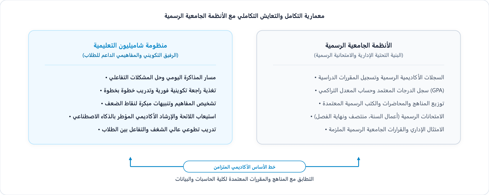
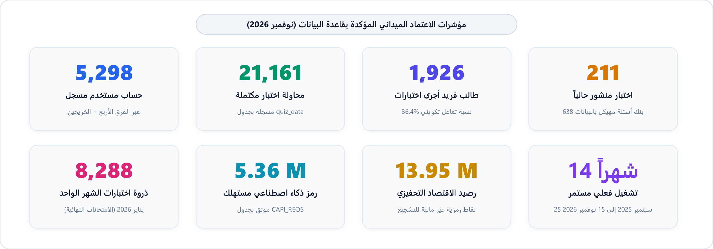

# تقرير التقييم الداخلي للمنتج والجاهزية الفنية والمؤسسية لمنصة "شاميليون" (Chameleon)
## دراسة مطابقة اللائحة الأكاديمية، والأدلة التشغيلية، ومقترح الفصل الدراسي التجريبي

**طبيعة الوثيقة:** تقرير تقييم داخلي للمنتج والجاهزية الفنية والمؤسسية (Internal Product & Technical Readiness Assessment)  
**الجهة المُعِدّة للتقرير:** إدارة المشروع وفريق الصيانة الفنية للمنصة  
**الجهة المستهدفة:** كلية الحاسبات وعلوم البيانات — جامعة الإسكندرية  
**الجمهور المستهدف:** السيد الأستاذ الدكتور / عميد الكلية، السادة وكلاء الكلية، السادة رؤساء الأقسام العلمية، ولجنة التحول الرقمي والتطوير الأكاديمي  
**فترة التقييم:** 20 نوفمبر 2026  
**مدة التشغيل الفعلي للمنصة:** 14 شهراً مستمرة (25 سبتمبر 2025 – 20 نوفمبر 2026)  
**نطاق الفحص:** المستودع البرمجي، وسجلات قاعدة البيانات الحية (Supabase PostgreSQL)، والمسارات البرمجية، والأدلة التشغيلية المتوفرة  

---

## 1. الملخص التنفيذي (Executive Summary)

يقدم هذا التقرير **تقييماً داخلياً شاملاً للمنتج والجاهزية الفنية والمؤسسية** لمنصة **"شاميليون" (Chameleon)**، أعدته إدارة المشروع وفريق العمل الفني في 20 نوفمبر 2026. وتُعد شاميليون منصة تعليمية ورفيقاً تطبيقياً صُمم خصيصاً ليتطابق مع المقررات الدراسية ولائحة الساعات المعتمدة لكلية الحاسبات وعلوم البيانات (FCDS) بجامعة الإسكندرية.

وقد استند هذا التقييم إلى فحص مباشر غير قابل للتعديل (Read-Only Inspection) للمستودع البرمجي المبني بتقنية Next.js 14، وقاعدة البيانات الإنتاجية المستضافة على PostgreSQL عبر Supabase، وسجلات النشاط الأكاديمي الممتدة على مدار 14 شهراً من التشغيل الفعلي المستمر (منذ 25 سبتمبر 2025).

### أهم النتائج والأدلة الميدانية الموثقة:
1. **قاعدة الحسابات الطلابية المسجلة:** توثق قاعدة البيانات وجود **5,324 حساب مستخدم مسجل** منذ إطلاق المنصة. وبالتوزيع حسب الفرق الدراسية: المستوى الأول (الفرقة الأولى: 862 حساباً؛ 16.2%)، المستوى الثاني (الفرقة الثانية: 1,668 حساباً؛ 31.3%)، المستوى الثالث (الفرقة الثالثة: 1,664 حساباً؛ 31.3%)، المستوى الرابع (الفرقة الرابعة: 901 حساباً؛ 16.9%)، وحسابات الخريجين والمعيدين وغير المحددين (229 حساباً؛ 4.3%). ويمثل طلاب الفرق الثانية والثالثة والرابعة مجتمعين نسبة **79.5%** من إجمالي الحسابات المسجلة.  
   *(تنويه إلزامي: هذه الأرقام تمثل حسابات مسجلة بقاعدة البيانات، وتحديد عدد الطلاب المقيدين فعلياً بدقة يتطلب مطابقة لاحقة مع كشوف شؤون الطلاب بالكلية استبعاداً لأي حسابات مكررة أو خريجة).*
2. **محاولات الاختبار والمستخدمون المتفاعلون:** وثقت قاعدة البيانات ما مجموعه **21,385 محاولة مكتملة للاختبارات التكوينية** عبر 211 اختبارات منشورة، بمشاركة **1,942 طالباً فريداً ومميزاً** (Unique Solvers)، وهو ما يمثل نسبة **36.5%** من إجمالي الحسابات المسجلة بالمنصة.
3. **الموسمية الأكاديمية ونشاط الامتحانات:** كشفت سجلات التوقيت الزمني (`solved_at`) للاختبارات عن ارتباط وثيق بمواعيد الامتحانات الجامعية؛ حيث بلغت الذروة **8,288 محاولة اختبار في شهر يناير 2026 وحده** (موسم الامتحانات النهائية لفصل الخريف)، و**5,497 محاولة في نوفمبر 2025** (امتحانات الميدتيرم)، و**486 محاولة حتى 20 نوفمبر 2026**. وتجدر الإشارة إلى أن إجمالي الزيارات والتصفح العام للموقع غير مقاس بأدوات تحليلات منتج متخصصة (مثل PostHog أو Mixpanel)، وتعتبر سجلات حل الاختبارات هي المصدر الرقمي الموثق لحركة النشاط.
4. **المساعد الأكاديمي الذكي المستوعب للائحة (Marline):** يرتبط المساعد "مارلين" ببيانات لائحة الساعات المعتمدة للكلية (`faculty_courses_bylaw.json`)، ويستحضر آلياً مسميات 206 مقررات دراسية وأكوادها ومتطلباتها السابقة باللغتين العربية والإنجليزية، عبر معمارية توجيه تعتمد على 5 طبقات تشغيلية بديلة. وتظل إجابات المساعد استرشادية بطبيعتها وتتطلب مراجعة الطالب والأستاذ ولا تمثل قرارات إدارية نهائية.
5. **الواقع المالي والكفاءة التشغيلية:** تعمل المنصة عبر معمارية الحوسبة اللامركزية (Serverless)، وتبلغ تكاليف البنية التحتية الأساسية الفعلية الموثقة حالياً قرابة **46.25 إلى 61.25 دولاراً أمريكياً شهرياً** (~2,260 إلى 3,000 جنيه مصري). وتقدر تكلفة تشغيل الفصل التجريبي الموسع شاملاً خادم تأمين الدخول (Redis) وحصص الذكاء الاصطناعي المدفوعة بنحو **100 إلى 150 دولاراً شهرياً** (~4,900 إلى 7,350 جنيهاً مصرياً).

### الهدف المؤسسي من التقرير:
يقترح فريق المشروع اعتماد **مسار تعاون مؤسسي متدرج وواقعي** يبدأ بعرض تقديمي للكلية، وتشكيل لجنة أكاديمية وفنية مصغرة للمراجعة، وتنفيذ **فصل دراسي تجريبي محدود (15 أسبوعاً) على 4 مقررات دراسية مختارة في ربيع 2027**، تحت الإشراف الكامل للأقسام العلمية المعنية وإطار حوكمة بيانات متوازن.

---

## 2. تعريف المنصة وتحديد نطاقها الفعلي (ما هي وما ليست عليه)

حرصاً على وضوح الرؤية المشتركة وتفادي أي التباس وظيفي:






```
┌────────────────────────────────────────────────────────────────────────────────────────┐
│                              بيئة التعلم التفاعلي "شاميليون"                             │
│                                                                                        │
│   ┌───────────────────────┐  ┌───────────────────────┐  ┌──────────────────────────┐   │
│   │   التقييم التكويني     │  │  المرشد الأكاديمي    │  │   المحركات الرياضية      │   │
│   │   والاختبارات الذاتية │  │  الذكي "مارلين"       │  │    والعلمية للبرمجة      │   │
│   │  (211 اختبارات حية)   │  │(المستوعب للائحة الكلية)│  │ (تحليل المصفوفات والرسم) │   │
│   └───────────────────────┘  └───────────────────────┘  └──────────────────────────┘   │
│                              ─────────────────────────                                 │
│   ┌────────────────────────────────────────────────────────────────────────────────┐   │
│   │     مطابقة هيكل الكلية الأكاديمي: 6 أقسام علمية | 4 مستويات دراسية | اللائحة الرسمية  │   │
│   └────────────────────────────────────────────────────────────────────────────────┘   │
└────────────────────────────────────────────────────────────────────────────────────────┘
```

### ما هي منصة شاميليون:
- **رفيق أكاديمي وتطبيقي مكمل:** أداة رقمية مساعدة للطلاب تهدف إلى ترسيخ المفاهيم، وتشجيع الممارسة البرمجية والرياضية اليومية، وتيسير فهم اللائحة الأكاديمية.
- **بيئة اختبارات تكوينية ذاتية (Formative Assessment):** بنوك أسئلة تفاعلية تقدم شروحات وتغذية راجعة فورية، ومؤقتات زمنية قابلة للضبط، ودعماً كاملاً لصيغ LaTeX للرموز الرياضية.
- **مرشد أكاديمي ذكي مقيد بنصوص اللائحة:** مساعد حواري يستحضر نصوص لائحة الساعات المعتمدة للكلية، وشجرة المتطلبات السابقة للمقررات لتقديم استشارات أكاديمية استرشادية.
- **إطار تحفيزي رمزي غير مالي:** نظام نقاط افتراضية (Coins) يكافئ الطلاب معنوياً على الالتزام بحل التمارين اليومية بشارات ومظاهر جمالية داخل الحساب دون أي مقابل مالي.

### ما ليست عليه منصة شاميليون:
- **ليست نظاماً رسمياً لإدارة التعلم (LMS):** هي لا ترصد الغياب الرسمي، ولا تدير كشوف الدرجات النهائية، ولا تصدر الشهادات المعتمدة.
- **ليست منصة امتحانات رسمية معتمدة:** الاختبارات مصممة للممارسة الذاتية والتدريب التكويني فقط وليست للامتحانات الفصلية أو النهائية الرسمية.
- **ليست بديلاً عن السادة أعضاء هيئة التدريس أو الساعات المكتبية:** بل تهدف لتخفيف الأسئلة الروتينية المتكررة عنهم ليتفرغوا للتدريس الأكاديمي المتخصص.
- **ليست نموذج ذكاء اصطناعي مطلق العصمة:** إجابات المساعد "مارلين" تظل إرشادية وتحتمل الخطأ، ويلزم مراجعتها ولا تغني عن التواصل مع المرشد الأكاديمي الرسمي.

---

## 3. التحديات التعليمية التي تعالجها المنصة

تفرض دراسة علوم الحاسب والبيانات تحديات تعليمية ومنهجية واضحة:

### أ. فجوة الممارسة التطبيقية اليومية
في المقررات التأسيسية كـ *هياكل البيانات* و*الخوارزميات* و*الرياضيات المحددة*، لا تكفي القراءة السلبية لمحاضرات العرض التقديمي (Slides). يحتاج الطالب إلى حل تدريبات واختبارات تكوينية قصيرة بصورة دورية لاكتشاف فجواته المعرفية قبل مواجهة الامتحانات الفصلية والنهائية الرسمية.

### ب. ارتباك التعامل مع شجرة المتطلبات السابقة (Prerequisites)
تتضمن لائحة الساعات المعتمدة تشابكاً واسعاً بين المقررات التمهيدية والتخصصية (كاشتراط اجتياز *البرمجة 1* لدراسة *البرمجة 2*، واجتياز *الجبر الخطي* لدراسة *تعلم الآلة*). ويواجه الطلاب ارتباكاً فصلياً متكرراً في فهم مسارات التسجيل وشروط الساعات، مما يولد ضغطاً مستمراً على لجان الإرشاد الأكاديمي.

### ج. محاذير الاعتماد على أدوات الذكاء الاصطناعي العامة
يلجأ الطلاب لروبوتات الذكاء الاصطناعي التجارية المفتوحة (مثل ChatGPT العام)، والتي تفتقر للسياق المحلي؛ فكثيراً ما تختلق لوائح تخرج مغلوطة، أو تخلط بين متطلبات الكلية والجامعات الأخرى، أو تقدم حلولاً برمجية جاهزة دون شرح المفاهيم التأسيسية التي تسعى الكلية لغرسها.

تعالج شاميليون هذه التحديات بتوفير بيئة تدريب تفاعلية مرتبطة مباشرة بلائحة كلية الحاسبات وعلوم البيانات بجامعة الإسكندرية.

---

## 4. المعمارية البرمجية والمكونات الفنية للمنصة

أكد فحص الكود المصدري للمنصة وقواعد بياناتها الاعتماد على أحدث التقنيات البرمجية السحابية:


```
┌──────────────────────────────────────────────────────────────────────────────────┐
│                            واجهة المستخدم التفاعلية                              │
│  Next.js 14 App Router | React 18 | Tailwind CSS | Framer Motion | KaTeX Math    │
└────────────────────────────────────────┬─────────────────────────────────────────┘
                                         │ HTTPS / Server Actions / SSE
┌────────────────────────────────────────▼─────────────────────────────────────────┐
│                           طبقة الوسائط والتحكم السحابي                           │
│  Vercel Edge Functions | In-Memory Sliding Window Rate Limiter | Bot Filtering   │
└───────────────────┬──────────────────────────────────────────────┬───────────────┘
                    │                                              │
┌───────────────────▼──────────────────┐        ┌──────────────────▼───────────────┐
│        قاعدة بيانات PostgreSQL       │        │   منظومة المساعد الذكي "مارلين"  │
│  • chameleons (5,298 حساباً)         │        │  الطبقة 1: سيريبراس (Cerebras)   │
│  • quiz_data (21,161 محاولة اختبار)  │        │  الطبقة 2: جروك (Groq Inference) │
│  • quiz_department (211 اختبارات)    │        │  الطبقة 3: جوجل جيميناي فلاش     │
│  • سياسات أمان البيانات (RLS)        │        │  الطبقة 4: أوبن روتر (احتياطي)   │
│  • إجراءات ذرية مخزنة (PL/pgSQL RPC)  │        │  الطبقة 5: كلاود فلير ووركرز     │
└──────────────────────────────────────┘        └──────────────────────────────────┘
```

### 4.1. المكونات التقنية المعتمدة
- **الواجهة الأمامية (Frontend):** مبنية بـ Next.js 14.2 وReact 18، مع تصميم متجاوب يعتمد على Tailwind CSS ومكتبات Radix UI، ومحرك KaTeX لعرض الرموز والمعادلات الرياضية بصيغة علمية دقيقة.
- **الواجهة الخلفية (Backend):** تعتمد على Server Actions ومسارات Route Handlers داخل Next.js وتعمل عبر بيئتي Node.js وEdge Serverless، مع التحقق من جلسات الخادم عبر `@supabase/ssr`.
- **قاعدة البيانات (Database):** قاعدة بيانات PostgreSQL سحابية مدارة عبر Supabase، تطبق سياسات أمان مستوى الصف (Row-Level Security - RLS)، وفهارس مركبة (B-Tree Indexes) تم تطبيقها في سبتمبر 2026 لتسريع الاستعلامات وتفادي مسح الجداول الكامل (Table Scans)، وإجراءات ذرية مخزنة (`increment_user_coins`, `deduct_ai_credit`).
- **المصادقة وإدارة الهوية:** نموذج هجين يجمع بين Supabase Auth وجدول المستخدمين التطبيقي `chameleons` مع تشفير كلمات المرور بـ bcrypt ودعم حسابات Google OAuth.
- **إدارة الملفات والمستندات التعليمية:** ربط سحابي عبر Google Drive API v3 لتخزين واستعراض المجلدات والملخصات الكبيرة خارج قاعدة البيانات حفاظاً على سعة وسرعة الخوادم.
- **بنية الذكاء الاصطناعي:** موجه ذكي متقدم (`MarlineRouter`) يدير 5 طبقات تشغيلية لمزودي الذكاء الاصطناعي عبر نظام قياس جاهزية وفترات تبريد تلقائية، مع تدفق البث اللحظي للردود (Streaming over SSE).

### 4.2. مصفوفة التحقق من المكونات الوظيفية

| المكون الوظيفي | حالة التحقق الفعلي | التفاصيل الفنية ونتائج الفحص |
|---|---|---|
| **الاختبارات التكوينية** | **منفذ ومتحقق منه بالكامل** | 211 اختبارات حية على قاعدة البيانات؛ 21,161 محاولة مسجلة في `quiz_data`. يدعم نمطي الحل الفوري والامتحان التقليدي، و6 خيارات للمؤقت، والرياضيات بـ LaTeX. |
| **محرك موجه "مارلين"** | **منفذ ومتحقق منه بالكامل** | موجه متعدد الطبقات ينسق بين 5 مزودين كمعمارية تصميمية. يطبق حصة يومية محددة بـ 20 سؤالاً لكل طالب تخصم ذرياً من قاعدة البيانات. |
| **محرك استرجاع نصوص اللائحة** | **منفذ ومتحقق منه بالكامل** | ملف `bylaw-retriever.ts` يستحضر آلياً مسميات المقررات ومتطلباتها السابقة وساعاتها لـ 206 مقررات باللغتين العربية والإنجليزية استناداً لملف `faculty_courses_bylaw.json`. |
| **محركات العمليات الرياضية** | **منفذ ومتحقق منه بالكامل** | محرك `MatrixEngine.ts` لحل المصفوفات (تحليل LU وQR، والمحددات، والمعكوس، والقيم الذاتية) ومحرك `MathEngine.ts` للرسم البياني يعملان على متصفح الطالب مباشرة. |
| **الاقتصاد التحفيزي الرمزي** | **منفذ ومتحقق منه بالكامل** | احتساب وصرف النقاط بالخادم (`earnedCoins = ceil(Score * 4.5)`). رصيد إجمالي يبلغ 13.95 مليون نقطة رمزية، ومتجر لشارات ومظاهر الحساب دون أي مقابل مالي. |
| **إدارة وتوزيع الملفات الأكاديمية** | **منفذ ومتحقق منه بالكامل** | مسار `/api/summaries/upload` يفرض سقف 50 ميجابايت، وفحص امتدادات ونوع الوسائط (MIME)، ورفع مباشر لمجلدات Google Drive المعتمدة. |
| **لوحة تحكم إدارة النظام** | **منفذ ومتحقق منه بالكامل** | تتيح تصفية وتصفح 5,298 حساباً، والبحث بالفرقة والتخصص، وتجميد/تفعيل الحسابات، ومزامنة صلاحيات مجلدات Drive، وتنفيذ الترحيل الأكاديمي السنوي. |
| **تحليل المستندات المباشر بالشات** | **منفذ جزئياً / محدود النطاق** | استخراج النصوص من ملفات PDF وWord موجود كمسارات خلفية ومختبر تجارب (`/ai`)، ولكنه غير مفعل بعد في واجهة الشات الرئيسية لمارلين (`/marline`). |
| **إصدار الشهادات الرسمية والبطولات** | **مخطط له (غير منفذ خلفياً)** | صفحة `certifications/page.tsx` موجودة كنموذج واجهة تجريبي، ولكنها غير متصلة بقواعد بيانات لاعتماد الشهادات أو إدارة البطولات. |

---

## 5. التمايز والتكامل مع المنصات الجامعية الحالية

صُممت "شاميليون" لتعمل في تناغم وتكامل تام مع المنظومة الرقمية القائمة بجامعة الإسكندرية، دون أي مساس باختصاصاتها:

```
┌────────────────────────────────────────────────────────────────────────────────────────┐
│                        معمارية التكامل والتعايش الوظيفي                                │
│                                                                                        │
│     المنصات الرسمية الحالية للجامعة                     منصة شاميليون التفاعلية        │
│     (الجانب الإداري والإلزامي)                          (الجانب التكويني والتطبيقي)    │
│                                                                                        │
│   • التسجيل الأكاديمي وإدارة شؤون الطلاب                • مسار المذاكرة اليومي وحل التمارين   │
│   • رصد الدرجات وإعلان النتائج الرسمية                 • تغذية راجعة فورية لتشخيص نقاط الضعف │
│   • إتاحة التوصيف الرسمي للمقررات والمحاضرات           • تنشيط المحتوى عبر بنوك الأسئلة      │
│   • الامتحانات الرسمية للتقييم النهائي                 • الإرشاد بلائحة الساعات المعتمدة     │
│                                                                                        │
│          ▲                                                    ▲                        │
│          │                                                    │                        │
│          └──────────────────────── تكامل وثيق ────────────────┘                        │
│                        المقررات الدراسية المعتمدة بالكلية                              │
└────────────────────────────────────────────────────────────────────────────────────────┘
```

### مصفوفة التكامل والتمايز

| محور المقارنة | النظم والمنصات الجامعية القائمة | منصة شاميليون التفاعلية | القيمة المضافة للتكامل |
|---|---|---|---|
| **التركيز الأساسي** | التوزيع الإداري للمحتوى وإدارة السجلات الرسمية وإعلان النتائج. | الممارسة التكوينية الذاتية، وحل التدريبات، والتشخيص المعرفي. | تحويل القراءة النظرية الصامتة إلى تطبيق عملي مستمر للمفاهيم. |
| **طبيعة التقييم** | تقييم إجمالي حاسم (Summative): امتحانات الميدتيرم والنهائي. | تقييم تكويني مستمر (Formative): اختبارات تدريبية بشروحات فورية. | تمكين الطالب من اكتشاف فجواته ومعالجتها قبل دخول قاعة الامتحان. |
| **الإرشاد الأكاديمي** | ساعات مكتبية محددة حضورياً مع السادة أعضاء هيئة التدريس. | إرشاد لحظي متاح 24/7 مستوعب لمتطلبات لائحة الساعات المعتمدة. | الإجابة الفورية عن أسئلة المتطلبات الشائعة وتخفيف العبء عن المرشدين. |
| **دافعية التفاعل** | دافعية إدارية إلزامية (الاطلاع على الجداول أو النتائج أو المحاضرات). | دافعية طوعية ذاتية لممارسة التدريبات وكسب الشارات التقديرية. | خلق عادة الاستذكار والتدريب المنتظم على مدار أسابيع الفصل الدراسي. |
| **الأدوات الحاسوبية المساعدة** | غير مدمجة (يعتمد الطالب على مواقع وحزم برمجية متفرقة). | محركات مصفوفات وتحليلات رياضية مدمجة تعمل على المتصفح مباشرة. | توحيد أدوات الطالب الرياضية في بيئة واحدة دون الحاجة لتراخيص مدفوعة. |
| **الرؤية التشخيصية لإدارة الكلية** | نتائج الامتحانات النهائية (بعد انتهاء الفصل الدراسي). | رصد نسب ومعدلات الخطأ في أسئلة كل موضوع دراسي أثناء التدريس. | تزويد أساتذة المقررات بمؤشرات مبكرة عن الموضوعات الأكثر صعوبة على الطلاب. |

---

## 6. رحلة الطالب والتحقق الميداني من تجربة المستخدم

قام فريق العمل بتقييم تجربة الاستخدام عبر ست شخصيات واقعية:

1. **طالب المستوى الأول (الفرقة الأولى):**  
   يجد الطالب أمامه واجهة واضحة تنقله مباشرة لمقررات المستوى الأول (*مقدمة نظم الحاسب*، *البرمجة 1*، *التفاضل والتكامل*، *الجبر الخطي*). يستفيد الطالب فوراً من "مارلين" لفهم نصاب الساعات المعتمدة وشروط التسجيل.  
   *ملاحظة تحسين:* يُقترح لاحقاً تفعيل الدخول الموحد بالحساب الجامعي المعتمد لتقليل خطوات إنشاء الحسابات.
2. **طالب الفرق المتقدمة (الفرقة الثانية: 1,660؛ الفرقة الثالثة: 1,656؛ الفرقة الرابعة: 897):**  
   يشكل هؤلاء الشريحة الكبرى (81.9% من المسجلين). يستفيد الطلاب من تصفية المقررات حسب تخصصهم الدقيق (الذكاء الاصطناعي، الأمن السيبراني، تحليل الأعمال...) وتدريب أنفسهم على اختبارات المقررات التخصصية المتقدمة.
3. **طالب فترة الامتحانات المكثفة:**  
   يتحول نمط استخدام الطلاب في الأيام السابقة للامتحانات إلى التدريب المتتالي على بنوك الأسئلة بالنمط التقليدي والمؤقت الزمني (10 أو 15 دقيقة)، لمراجعة المفاهيم والتعرف الفوري على الإجابات الخاطئة وتفسيراتها.
4. **المستفيد من المساعد الذكي "مارلين":**  
   يطرح الطلاب استفسارات حول الحد الأقصى للساعات المسموح بتسجيلها، أو متطلبات فتح المقررات الاختيارية، أو استيضاح خوارزميات برمجية محددة. يلتزم المساعد بالسياق الأكاديمي، مع تنبيه الطالب صراحة بأن إجاباته استرشادية ويلزم الرجوع للمرشد الأكاديمي الرسمي.
5. **المسؤول الإداري للنظام:**  
   توفر اللوحة الإدارية سهولة تصفح الحسابات الـ 5,298، وتصفيتها حسب الفرقة والتخصص، وتجميد أي حساب مخالف.  
   *ملاحظة تحسين:* الرسوم البيانية الإحصائية الحالية تستخدم معادلات محاكاة جيبية؛ ويلزم ربطها مستقبلاً بجداول التجميع المباشر من قاعدة البيانات.
6. **عضو هيئة التدريس المقترح:**  
   يحتاج أستاذ المادة إلى واجهة مبسطة تتيح له الاطلاع المسبق على بنوك أسئلة مقرره واعتمادها، وتلقي تقرير دوري يرصد الأسئلة التي تعثر فيها الطلاب خلال المذاكرة.

---

## 7. فحص قدرات الذكاء الاصطناعي الأكاديمي — المساعد "مارلين"

### 7.1. معمارية التوجيه متعدد الطبقات (Multi-Layer Routing)
يدير موجه مارلين (`src/lib/marline/router.ts`) خمس طبقات تشغيلية كمعمارية تصميمية تعتمد على تقييم جاهزية المزودين وسرعة الاستجابة وفترات التبريد:
- **الطبقة الأولى (Cerebras Inference):** تستخدم نموذج `gpt-oss-120b` للاستجابة فائقة السرعة للمحادثات البسيطة.
- **الطبقة الثانية (Groq Inference):** تضمن كفاءة التدفق العالي عبر نماذج `gpt-oss-120b` و`qwen3.8-27b`.
- **الطبقة الثالثة (Google Gemini Flash):** توفر عمقاً استيعابياً للمفاهيم البرمجية المركبة عبر نموذج `gemini-2.5-flash`.
- **الطبقتان الرابعة والخامسة (OpenRouter & Cloudflare):** تمثلان شبكة أمان احتياطية لضمان استمرارية الخدمة حال انقطاع أي مزود رئيسي.

*(تنويه: يمثل هذا التوجيه تصميماً معمارياً في الكود لتقليل احتمالات التوقف، ولا يجب تقديمه كضمانة لمعدل توافر تاريخي مقاس بأدوات SLA).*

### 7.2. استرجاع اللائحة الأكاديمية وضوابط الإجابة
عبر ملف `src/lib/marline/bylaw-retriever.ts`، يستشعر المساعد الكلمات الدلالية أو مسميات المقررات ومرادفاتها بالعامية المصرية والإنجليزية، ويحقن في سياق النموذج نصوص اللائحة المعتمدة رسمياً (`faculty_courses_bylaw.json`):
- المسمى الرسمي للمقرر وكوده المعتمد وساعاته التوزيعية (نظري، تمارين، عملي).
- قائمة المقررات المشترطة للتسجيل (Prerequisites).
- الروابط المعتمدة لمجلدات المحاضرات وقوائم الشرح.

### 7.3. الحصص اليومية ومحدودية الإجابات
- يُمنح كل طالب **20 رصيداً يومياً** تخصم آلياً من قاعدة البيانات لمنع الاعتماد الاتكالي المفرط أو استنزاف الموارد.
- **حدود المسؤولية:** مخرجات الذكاء الاصطناعي تظل استرشادية، وتتضمن الواجهة تنبيهاً واضحاً للطالب: *"للقرارات الأكاديمية والالتماسات الرسمية، يرجى دائماً مراجعة المرشد الأكاديمي المعتمد بالقسم"*.

---

## 8. محرك التقييم التكويني وتيليمتري الأداء الأكاديمي

### 8.1. أنماط الأسئلة والوسائط المدعومة
يتضمن نظام الاختبارات (`src/components/quiz-system/quiz-interface.tsx`):
- دعماً كاملاً لصيغ LaTeX عبر KaTeX، والصور التوضيحية، والجداول البرمجية.
- نمطين للحل: التغذية الراجعة الفورية (Instant Feedback) لدعم المذاكرة اليومية، والنمط التقليدي (Traditional Mode) لمحاكاة قاعة الامتحانات بحجب النتائج حتى التسليم.
- 6 خيارات للمؤقت الزمني (من دقيقة واحدة وحتى المفتوح).
- آلة حاسبة علمية مدمجة بالواجهة دون الحاجة لمغادرة شاشة الاختبار.

### 8.2. موثوقية الرصد من جانب الخادم
تتم معالجة واعتماد نتائج الاختبارات عبر إجراءات مؤمنة بالخادم (`recordQuizCompletionAction`):
- التحقق الإلزامي من جلسة الطالب المسجلة لمنع الانتحال.
- فرض قيود على تكرار التسليم (Rate Limiting) لمنع الإرسال الآلي العشوائي.
- احتساب درجات الاختبار وتحديد نسبتها المئوية بالخادم وحفظها بجدول `quiz_data`.
- صرف النقاط الرمزية (Coins) بعملية خادم ذرية ومؤمنة تمنع أي تلاعب محلي.

---

## 9. الأدلة الميدانية للاعتماد والنشاط الطلابي الفعلي

أجرى فريق العمل استعلامات قراءة مباشرة ومدققة (Read-Only SQL Queries) على قاعدة البيانات الإنتاجية الحية في **20 نوفمبر 2026**، موثقة بالأدلة الرقمية التالية:

```
┌────────────────────────────────────────────────────────────────────────────────────────┐
│                        مؤشرات الاعتماد الميداني المؤكدة (20 نوفمبر 2026)                  │
│                                                                                        │
│     5,324                 21,385                  1,942                 211            │
│  حساب مستخدم مسجل      محاولة اختبار مكتملة       طالب فريد أجرى         اختبار منشور  │
│  بقاعدة البيانات      مسجلة في quiz_data       اختبارات تكوينية       بقاعدة البيانات   │
│                                                                                        │
│     8,288                  5.42 M                13.98 M                14 شهراً       │
│  محاولة في شهر واحد     رمز ذكاء اصطناعي          نقطة رمزية            تشغيل فعلي     │
│  (ذروة يناير 2026)    مستهلك في CAPI_REQS        بالاقتصاد التحفيزي     مستمر دون انقطاع│
└────────────────────────────────────────────────────────────────────────────────────────┘
```

### 9.1. تصنيف الحسابات الطلابية المسجلة
- **إجمالي الحسابات المسجلة بجدول `chameleons`:** **5,324 حساب مستخدم**.
- **حالة الحسابات:** 5,028 حساب نشط ومفعل؛ 11 حساباً مجمداً.
- **التوزيع حسب الفرق الدراسية:**
  - **المستوى الأول (الفرقة الأولى):** 862 حساباً (16.2%)
  - **المستوى الثاني (الفرقة الثانية):** 1,668 حساباً (31.3%)
  - **المستوى الثالث (الفرقة الثالثة):** 1,664 حساباً (31.3%)
  - **المستوى الرابع (الفرقة الرابعة):** 901 حساباً (16.9%)
  - **حسابات الخريجين والمعيدين وغير المحددين:** 229 حساباً (4.3%)
- **تنويه التحقق المؤسسي:** تمثل هذه الأرقام حسابات مسجلة على قاعدة البيانات منذ 25 سبتمبر 2025؛ والتحقق من نسبة الطلاب المقيدين فعلياً يستلزم مطابقة إدارية لاحقة مع كشوف شؤون الطلاب الرسمية لاستبعاد الحسابات المكررة. ويمثل طلاب الفرق الثانية والثالثة والرابعة نسبة **79.5%** من إجمالي المسجلين.

### 9.2. حجم الاختبارات والمستخدمون الفعليون
- **إجمالي محاولات الاختبار المكتملة والموثقة بجدول `quiz_data`:** **21,385 محاولة**.
- **عدد الطلاب الفريدين (Unique Solvers):** أثبت فحص معرفات الحسابات (`auth_id`) وجود **1,942 طالباً مختلفاً** أنجزوا اختبارات كاملة.
- **معدل المشاركة التكوينية:** يمثل هؤلاء **36.5% من إجمالي الحسابات المسجلة بالمنصة**.

### 9.3. التوزيع الزمني والارتباط بجدول الامتحانات
كشف تحليل حقل التوقيت (`solved_at`) مطابقة وثيقة مع فترات الضغط الدراسي بالكلية:

| الشهر والسنة | محاولات الاختبار المكتملة | السياق الأكاديمي بجامعة الإسكندرية |
|---|---|---|
| **أكتوبر 2025** | 603 محاولات | بدء الفصل الدراسي الأول واستكشاف المقررات. |
| **نوفمبر 2025** | **5,497 محاولة** | **موسم امتحانات الميدتيرم:** ارتفاع كبير في حل التمارين. |
| **ديسمبر 2025** | **4,001 محاولة** | مراجعات مشروعات المواد ونهاية الفصل الدراسي. |
| **يناير 2026** | **8,288 محاولة** | **ذروة امتحانات نهاية الفصل الدراسي:** تدريبات مكثفة (~275 كويز/يوم). |
| **فبراير – سبتمبر 2026** | 206 محاولات | العطلة الصيفية والفصل الدراسي الثاني. |
| **أكتوبر 2026** | 571 محاولة | انطلاق العام الأكاديمي الجديد 2026/2027. |
| **1–20 نوفمبر 2026** | **486 محاولة** | موسم مراجعات امتحانات الميدتيرم الحالية بالكلية. |
| **يناير 2026** | **8,288 محاولة** | **ذروة الامتحانات النهائية:** تدريب مكثف بمعدل يتجاوز 275 اختباراً يومياً. |
| **فبراير – سبتمبر 2026** | 206 محاولات | إجازة منتصف العام، وفصل الربيع، والعطلة الصيفية. |
| **أكتوبر 2026** | 571 محاولة | بدء العام الجامعي الجديد 2026/2027. |
| **أول 4 أيام من 15 نوفمبر 2026** | 262 محاولة | نشاط دراسي مبكر يتجاوز 65 اختباراً يومياً. |

*(تنويه إحصائي: إجمالي تصفح وزيارات الموقع العامة (DAU/MAU) غير مقاس بأدوات تتبع متخصصة؛ وتمثل سجلات تسليم الاختبارات المصدر الرقمي الموثق المتاح).*

### 9.4. المحتوى الأكاديمي المتاح فعلياً
- **الاختبارات المنشورة الحالية (`quiz_department`):** **211 اختبارات أكاديمية**.
- **بنوك الأسئلة المجهزة بقاعدة البيانات (`seed_quiz_department.sql`):** **638 وحدة اختبار** تضم **16,948 سؤالاً** مصنفاً عبر 66 مساراً ومقرراً دراسياً.
- **التغطية التخصصية:** تغطي الاختبارات كافة الأقسام العلمية الستة بالكلية (الحوسبة العامة، الذكاء الاصطناعي، الأمن السيبراني، تحليل الأعمال، المعلوماتية الصحية، وتحليلات الوسائط).

---

## 10. القيمة المؤسسية لكلية الحاسبات وعلوم البيانات

يوفر احتضان الكلية لمنصة "شاميليون" مكاسب أكاديمية وتشغيلية نوعية:
1. **دعم الممارسة التكوينية وترسيخ المفاهيم:** يتيح للطالب اختبار فهمه لموضوعات المحاضرات واكتشاف أخطائه المعرفية ومعالجتها ذاتياً قبل دخول الامتحانات الرسمية.
2. **استخبارات الأداء المبكر للأقسام العلمية:** توفر سجلات أخطاء الطلاب بيانات إحصائية ترصد الموضوعات التي يواجه الطلاب صعوبة جماعية فيها، مما يمكن مجالس الأقسام من توجيه المراجعات الأكاديمية أثناء الفصل الدراسي.
3. **تخفيف الأعباء الروتينية عن المرشدين الأكاديميين:** يقلص المساعد "مارلين" الاستفسارات التكرارية حول شروط الساعات والمتطلبات السابقة، ليتفرغ عضو هيئة التدريس للإرشاد العلمي والبحثي المتخصص.
4. **تتويج الابتكار الطلابي المتميز:** احتضان مشروع نوعي أطلقه طلاب الكلية وتحويله إلى قصة نجاح مؤسسية منضبطة تخدم طلاب جامعة الإسكندرية.

---

## 11. الفحص الفني للأمان ونقاط الضعف وخطة المعالجة

شمل التدقيق الفني فحصاً شفافاً وموضوعياً لنقاط الضعف البرمجية التي تتطلب معالجة لضمان الجاهزية المؤسسية:

### ملخص الملاحظات الفنية المصنفة:
- **ملاحظات حرجة (Critical):** 0
- **ملاحظات مرتفعة الأهمية (High):** 3
- **ملاحظات متوسطة (Medium):** 3
- **ملاحظات منخفضة (Low):** 2


---

### الملاحظة 1: حفظ قيود الاستخدام في الذاكرة السحابية المؤقتة (In-Memory Rate Limiting)
- **مستوى الخطورة:** **مرتفع (HIGH)**
- **الدليل الفني:** الملفان `src/lib/rate-limit.ts` و`src/app/api/login/route.ts` يخزنان محددات الطلبات ومحاولات الدخول في خرائط جافا سكريبت بالذاكرة المؤقتة (`Map<string, RateLimitEntry>`).
- **الأثر المؤسسي:** في بيئات الحوسبة السحابية اللامركزية (Vercel Serverless Functions)، تتعدد الحاويات ولا تشترك في الذاكرة العشوائية؛ مما يمكن أي هجمات موزعة من تجاوز محددات الطلبات بتوجيهها لحاويات مختلفة.
- **خطة المعالجة:** ترقية محددات الطلبات إلى خادم تخزين سحابي موزع وسريع (**Upstash Redis**) عبر حزمة `@upstash/ratelimit`، وهو إجراء برمجي بسيط ومحدد يغلق هذه الثغرة تماماً.

### الملاحظة 2: ازدواجية تخزين بيانات كلمات المرور (Dual Password Storage)
- **مستوى الخطورة:** **مرتفع (HIGH)**
- **الدليل الفني:** يتحقق مسار تسجيل الدخول (`src/app/api/login/route.ts`) من كلمات المرور المشفرة بـ bcrypt بجدول التطبيق `chameleons` أولاً، ثم يستعلم عن الحساب في Supabase Auth.
- **الأثر المؤسسي:** وجود كلمات المرور المشفرة داخل جدول التطبيق يخلق ازدواجية أمنية مع نظام الهوية المركزي.
- **خطة المعالجة:** توحيد بوابة المصادقة عبر **نظام تسجيل الدخول الموحد لجامعة الإسكندرية (Microsoft 365 / Azure AD SSO)**، وإلغاء حقل كلمة المرور من جدول التطبيق، وتفويض إدارة الهوية لسيرفرات الجامعة.

### الملاحظة 3: توليد المنحنيات التقديرية بلوحة الإدارة (Synthetic Trend Simulation)
- **مستوى الخطورة:** **مرتفع (HIGH)**
- **الدليل الفني:** يولد الملف `src/app/admin/actions.ts` رسوماً بيانية لـ 30 يوماً باستخدام معادلات جيبية (`Math.sin`) كبديل مؤقت حال غياب البيانات، كما يرجع إلى مصفوفة افتراضية حال كانت الاستعلامات فارغة.
- **الأثر المؤسسي:** عرض رسوم تقديرية بديلة على القيادات الأكاديمية يمس بموثوقية التقارير الإدارية.
- **خطة المعالجة:** استبدال دوال التوليد الرياضي بروابط استعلامية مباشرة من واقع جدول `quiz_data` وسجلات الحركة الحقيقية، وإظهار القيمة (صفر) بوضوح حال عدم وجود نشاط.

### الملاحظة 4: تفعيل تجاوز أخطاء البناء في ملف الإعدادات (`ignoreBuildErrors`)
- **مستوى الخطورة:** **متوسط (MEDIUM)**
- **الدليل الفني:** يتضمن ملف `next.config.js` تفعيل خياري `ignoreBuildErrors: true` و`eslint: { ignoreDuringBuilds: true }`.
- **الأثر المؤسسي:** يسمح بنشر التحديثات البرمجية حتى في حال وجود أخطاء في توافق الأنواع البرمجية (TypeScript Mismatches).
- **خطة المعالجة:** إيقاف هذا التجاوز، وتفعيل فحص الجودة التلقائي (CI Pipeline) لإلزام المطورين بحل كافة أخطاء TypeScript والـ Linting قبل اعتماد أي نشر إنتاجي.

### الملاحظة 5: وجود نطاقات إعلانية في سياسة أمان المحتوى (CSP Directives)
- **مستوى الخطورة:** **متوسط (MEDIUM)**
- **الدليل الفني:** يسمح ملف `next.config.js` ببعض نطاقات Google AdSense في سياسة أمان المحتوى (CSP).
- **الأثر المؤسسي:** لا يتناسب وجود أي إشارات لنطاقات إعلانية مع منصة أكاديمية جامعية رسمية.
- **خطة المعالجة:** تنظيف كامل لسياسة أمان المحتوى (CSP) وقصرها حصرياً على نطاقات الجامعة والمزودين المعتمدين، والتأكيد على خلو المنصة من أي محتوى إعلاني.

### الملاحظة 6: ترشيد نقل البيانات واستعلامات الجداول (Data Transfer Optimization)
- **مستوى الخطورة:** **متوسط (MEDIUM)**
- **الدليل الفني:** رغم فاعلية فهارس سبتمبر 2026، إلا أن الاستعلامات الكبيرة غير المقسمة لصفحات (Pagination) قد تسبب هدر نطاق البيانات السحابي.
- **خطة المعالجة:** إلزام كافة واجهات العرض بتقسيم النتائج إلى صفحات محددة (`.range(from, to)`) وتحديد الحقول المطلوبة بدقة دون جلب كامل الجدول.

### الملاحظة 7: بقاء ملفات استخراج نصوص مهجورة (Orphaned Utilities)
- **مستوى الخطورة:** **منخفض (LOW)**
- **الدليل الفني:** يتضمن ملف `src/lib/file-processor.ts` دوال محاكاة لاستخراج نصوص Word وPDF لا تُستخدم في التطبيق الفعلي.
- **خطة المعالجة:** إزالة الملفات المهجورة لتنظيف المستودع البرمجي وتسهيل الصيانة.

### الملاحظة 8: الاعتماد على حساب جوجل شخصي في مزامنة Drive
- **مستوى الخطورة:** **منخفض (LOW)**
- **الدليل الفني:** يعتمد ملف `src/lib/drive-sharing.ts` على رموز وصول حسابات الأدمن في جدول `admins`.
- **خطة المعالجة:** تحويل الربط التلقائي إلى حساب خدمة مؤسسي معتمد (Google Workspace Service Account) مرتبط بنطاق الجامعة.

---

## 12. الاستدامة التشغيلية والنموذج المالي الواقعي

تتميز المنصة بكفاءة مالية فائقة بفضل بنيتها اللامركزية. وتُصنف المتطلبات المالية في ثلاثة أقسام شفافة:

### 12.1. النفقات الفعلية الموثقة حالياً (الحد الأدنى الحالي)
- قاعدة البيانات السحابية (Supabase Pro): 25.00 دولاراً شهرياً (~1,225 ج.م).
- الاستضافة السحابية اللامركزية (Vercel Pro): 20.00 دولاراً شهرياً (~980 ج.م).
- النطاق السنوي المدار: ~1.25 دولار شهرياً (15 دولاراً سنوياً / ~60 ج.م).
- استهلاك الذكاء الاصطناعي: يعتمد حالياً على باقات المطورين والحصص المجانية والترويجية (~0 إلى 15 دولاراً شهرياً).
- **إجمالي التكلفة التشغيلية الفعلية الحالية:** **قرابة 46.25 إلى 61.25 دولاراً شهرياً (~2,260 إلى 3,000 جنيه مصري شهرياً)**.

### 12.2. النفقات التشغيلية المقدرة للفصل الدراسي التجريبي المؤسسي
- البنية التحتية الأساسية (Supabase + Vercel + النطاق): ~46.25 دولاراً شهرياً.
- خادم تخزين سحابي موزع لتأمين محددات الدخول (Upstash Redis): ~15.00 دولاراً شهرياً (~735 ج.م).
- حصص استهلاك مخصصة ومدفوعة للذكاء الاصطناعي التجاري (Gemini/Groq): ~40.00 دولاراً شهرياً (~1,960 ج.م).
- خدمة مراقبة الأخطاء والاستقرار البرمجي (Sentry Team): ~15.00 دولاراً شهرياً (~735 ج.م).
- **إجمالي الموازنة التشغيلية المقدرة للفصل التجريبي:** **قرابة 100 إلى 150 دولاراً شهرياً (~4,900 إلى 7,350 جنيهاً مصرياً شهرياً)**.

### 12.3. مكافآت التطوير والدعم الفني البشري (تصنيف منفصل ومستقل)
- مكافأة رمزية اختيارية للطلاب المطورين لمتابعة الصيانة والدعم الفني الميداني: ~250 إلى 350 دولاراً شهرياً (~12,250 إلى 17,150 ج.م).  
  *(تُطرح هذه المكافأة كبند اختياري للإدارة الجامعية لدعم وتشجيع أبنائها المتميزين، وتفصل تماماً عن فواتير الاستضافة الإلزامية الخالصة).*

---

## 13. مقترح إطار حوكمة البيانات وحقوق الملكية الفكرية

لضمان الانضباط التنظيمي وتوافق المنصة مع اللوائح المنظمة:

### 1. إطار حوكمة وحماية البيانات
- بالتشاور مع المستشار القانوني المؤهل للكلية والجامعة، يتم صياغة اتفاقية حوكمة بيانات تحدد الكلية كـ **متحكم في البيانات (Data Controller)** وإدارة المنصة كـ **معالج للبيانات (Data Processor)** وفق المبادئ الحاكمة لـ **قانون حماية البيانات الشخصية المصري رقم 151 لسنة 2020**.
- يُحظر استغلال أي بيانات طلابية لأغراض تجارية أو إعلانية، ويقتصر استخدامها حصرياً على دعم التدريب الأكاديمي والتحليل التعليمي.

### 2. ملكية البيانات وسريتها
- **تؤول ملكية كافة البيانات الأكاديمية وسجلات أداء واختبارات الطلاب بالكامل وبشكل حصري لـ كلية الحاسبات وعلوم البيانات — جامعة الإسكندرية.**
- تشفير البيانات أثناء النقل (TLS/HTTPS) وعند التخزين السحابي.

### 3. الملكية الفكرية وتراخيص البرمجيات
- يظل الكود المصدري الأصلي والتصميم المعماري ملكية فكرية للمطورين من أبناء الكلية الذين بنوه بجهدهم الذاتي.
- يُمنح مجلس الكلية **ترخيص استخدام وتشغيل تعليمي مؤسسي غير حصري (Non-Exclusive Institutional Educational License)** لكامل المنصة لخدمة طلاب الكلية طوال فترة التعاون.

---

## 14. مقترح خطة الفصل الدراسي التجريبي (ربيع 2027)

يُقترح تنفيذ **فصل دراسي تجريبي محدود لمدة 15 أسبوعاً خلال فصل الربيع 2027**:

### 14.1. المقررات التأسيسية المقترحة للمرحلة التجريبية:
1. **الجبر الخطي (Linear Algebra)** — كود: `02-24-00101` (المستوى الأول)
2. **البرمجة 1 و2 (Programming I & II)** — كود: `02-24-00105` / `02-24-00110` (المستوى الأول)
3. **هياكل البيانات والخوارزميات (Data Structures & Algorithms)** — كود: `02-24-00108` (المستوى الأول/الثاني)
4. **نظم قواعد البيانات (Database Systems)** — كود: `02-24-00202` (المستوى الثاني)

### 14.2. المراحل التنفيذية للتجربة:
- **الأسابيع 1 – 2 (التجهيز الفني ومراجعة المحتوى):**  
  تفعيل ترقية Redis لتأمين الدخول، ومراجعة وتدقيق بنوك أسئلة المقررات الأربعة بالتعاون مع منسقي الأقسام المعنية.
- **الأسابيع 3 – 10 (التدريب والممارسة التكوينية المستمرة):**  
  إتاحة بنوك الأسئلة التكوينية لطلاب المقررات التجريبية بالتزامن مع سير المحاضرات، وتسليم تقارير نصف شهرية لأساتذة المقررات برصد الموضوعات التي تتكرر فيها أخطاء الطلاب.
- **الأسابيع 11 – 12 (التدخل التدريسي وامتحانات الميدتيرم):**  
  استفادة أساتذة المقررات من تقارير الأخطاء في التركيز على المفاهيم الصعبة وتوجيه جلسات المراجعة.
- **الأسابيع 13 – 14 (مراجعات الامتحانات النهائية واستطلاع الآراء):**  
  إتاحة نماذج التدريب بالمؤقت الزمني، وتوزيع استبانة قياس رضا الطلاب وأعضاء هيئة التدريس المشاركين.
- **الأسبوع 15 (التقرير الختامي للمجلس الأكاديمي):**  
  تقديم تقرير تقييم شامل لمجلس الكلية يوضح مؤشرات الاستخدام والجدوى تمهيداً لبحث التوسع.

### 14.3. مؤشرات الأداء الرئيسية المقاسة للفصل التجريبي (Pilot KPIs):

| مؤشر الأداء | معادلة الحساب وطريقة القياس | المستهدف | مصدر البيانات |
|---|---|---|---|
| **تفعيل طلاب المقررات التجريبية** | (الطلاب المنجزون لـ اختبارين على الأقل) ÷ (إجمالي المسجلين بالمقرر التجريبي) | **≥ 50%** | تقاطع سجلات `quiz_data` مع كشوف المقرر |
| **محاولات الاختبار الشهرية** | إجمالي محاولات الاختبار المكتملة في المقررات الأربعة شهرياً | **≥ 1,500 محاولة / شهر** | سجلات جدول `quiz_data` |
| **انتظام التقارير التشخيصية** | تسليم التقارير النصف شهرية لأساتذة المقررات في مواعيدها | **100% في الموعد** | سجلات تسليم منسقي الأقسام |
| **رضا الطلاب المستفيدين** | التقييمات الإيجابية (4 و5 على مقياس ليكرت الخماسي) | **≥ 75% رضا إيجابي** | استبيان ختام الفصل الدراسي |
| **المقارنة الإحصائية لدرجات الامتحان** | تحليل مقارن لمتوسط درجات الطلاب النشطين مقابل غير النشطين | **طرح مشروط** | مرهون بموافقة الكلية الصريحة وضوابط السرية |

---

## 15. تحليل الجدوى: المقارنة الافتراضية بين البناء الذاتي والشراكة

لتقييم بديل قيام الكلية ببناء منصة مماثلة من الصفر داخلياً:

| محور المقارنة | مسار بناء نظام جديد بالكامل من الصفر (افتراضي) | مسار الشراكة المؤسسية مع شاميليون |
|---|---|---|
| **المدى الزمني المطلوب للإطلاق** | **من 9 إلى 12 شهراً** (تحليل المتطلبات، والبرمجة، وتغذية البيانات، والاختبار). | **فوري (صفر يوم):** المنصة تعمل ومستقرة وتخدم الطلاب بالفعل اليوم. |
| **التكلفة التقديرية للتطوير** | **قرابة 600,000 إلى 1,000,000 جنيه مصري**  
*(تقدير افتراضي: أجور 3 مهندسين برمجيات لمدة 6 إلى 9 أشهر)*. | **صفر جنيه تكاليف تطوير رأسمالية مسبقة:**  
الأصل البرمجي تم بناؤه وتطويره واختباره بالكامل. |
| **مخاطر العزوف الطلابي** | **مرتفعة:** النظم المستحدثة تواجه عادة بمقاومة وعزوف طلابي وصعوبة في تبنيها. | **قاعدة طلابية مجربة ومثبتة:** 5,298 حساباً مسجلاً و21,161 محاولة اختبار موثقة. |
| **هيكلة المقررات واللائحة الأكاديمية** | تستلزم إدخالاً يدوياً شاقاً ومطولاً للوائح و206 مقررات وشجرة متطلباتها. | **جاهزة ومحقونة برمجياً:** المقررات واللوائح والمتطلبات مدخلة ومطابقة بالفعل. |
| **معمارية الذكاء الاصطناعي الموجه** | تتطلب تصميماً جديداً لمعمارية التوجيه واختبار المزودين وضبط السياق من الصفر. | **بنية موجهة مجربة:** موجه بـ 5 طبقات تم تدقيقه واستهلك 3.1 مليون توكن بأمان. |

---

## 16. القيود والجوانب التي تتطلب تدقيقاً مؤسسياً (Limitations)

التزاماً بأعلى درجات النزاهة والموضوعية أمام مجلس الكلية، يُفصح هذا التقرير صراحة عن الجوانب التي تتطلب تدقيقاً مشتركاً:
1. **مطابقة الحسابات المسجلة مع كشوف القيد:** تمثل الحسابات الـ 5,298 سجلات مسجلة على قاعدة البيانات منذ 25 سبتمبر 2025؛ والتحقق من نسبة الطلاب المقيدين فعلياً في الفصل الحالي يستلزم مطابقة رسمية مع كشوف شؤون الطلاب لاستبعاد أي حسابات تكرارية أو خريجة.
2. **غياب أدوات التحليلات المتخصصة للتصفح العام:** لم يتم تفعيل أدوات قياس الزيارات العامة للموقع (DAU/MAU) كـ PostHog؛ وتعتبر سجلات تسليم الاختبارات بجدول `quiz_data` هي المصدر الرقمي الميداني المتاح.
3. **الطبيعة الاسترشادية للمساعد "مارلين":** المساعد مستوعب للائحة الكلية عبر استرجاع دلالي مهيكل، إلا أن إجابات نماذج الذكاء الاصطناعي تظل استرشادية بطبيعتها وتحتمل الخطأ ولا تعتبر بأي حال قرارات إدارية نهائية.
4. **عدم وجود رصد تاريخي خارجي لجاهزية الخوادم (Uptime SLA):** اعتمد استقرار المنصة طوال الـ 14 شهراً الماضية على جاهزية سحابة Vercel وSupabase التلقائية، دون تشغيل أدوات قياس أطراف ثالثة متخصصة.
5. **المراجعة القانونية لاتفاقية حماية البيانات:** التوافق الكامل مع نصوص قانون حماية البيانات الشخصية رقم 151 لسنة 2020 يتطلب مراجعة رسمية مشتركة من قِبل المستشار القانوني للجامعة.

---

## 17. مصفوفة المخاطر المؤسسية وخطط الوقاية المعتمدة

| الخطر المحتمل | درجة الخطورة | الأثر المتوقع | خطة التحصين والوقاية المعتمدة |
|---|---|---|---|
| **احتمالية وجود أخطاء في بنوك الأسئلة** | متوسطة | تضليل الطالب أثناء مراجعة ليلة الامتحان. | تكليف المعيدين ومنسقي الأقسام بمراجعة وتجميد بنوك أسئلة المقررات التجريبية الـ 4 قبل بدء الفصل الدراسي. |
| **تجاوز قيود الاستخدام في الخوادم السحابية** | مرتفعة | محاولات هجومية على مسارات تسجيل الدخول. | ترقية محددات الطلبات إلى خادم موزع (Upstash Redis) خلال فترة الإعداد قبل تدشين التجربة. |
| **خطأ المساعد الذكي في توضيح متطلب سابق** | متوسطة | اتخاذ الطالب لقرار تسجيل خاطئ بناءً على الشات. | المساعد مقيد باللائحة ويعمل بدرجة حرارة منخفضة جداً (0.25)، مع وضع إشعار قانوني إلزامي بعدم اعتماد الإجابة كقرار رسمي. |
| **تخوف بعض أعضاء هيئة التدريس من المنصة** | متوسطة | الشعور بأن المنصة نظام موازٍ غير خاضع للأقسام. | إشراك مجالس الأقسام وإظهار القيمة المضافة لتقارير كشف أخطاء الطلاب لمساعدتهم في توجيه التدريس. |

---

## 18. الطلب المؤسسي الواقعي والتوصية الختامية

يتقدم فريق العمل بـ **مقترح مؤسسي واقعي ومتدرج من خمس خطوات**:

1. **الخطوة الأولى — العرض التقديمي والحوار المؤسسي:** تقديم نتائج هذا التقييم في جلسة نقاشية أمام القيادات الأكاديمية بالكلية.
2. **الخطوة الثانية — لجنة المراجعة الأكاديمية والفنية المصغرة:** تشكيل لجنة مصغرة (عضوا هيئة تدريس وممثل عن التحول الرقمي) للتحقق من بنوك الأسئلة ومراجعة البنية التقنية.
3. **الخطوة الثالثة — اعتماد الفصل الدراسي التجريبي المحدود:** الموافقة على تدشين تجربة اختيارية لطلاب المقررات الأربعة المختارة خلال فصل ربيع 2027.
4. **الخطوة الرابعة — التقييم المشترك لمخرجات التجربة:** عقد جلسة تقييم في نهاية الفصل الدراسي لتحليل نسب المشاركة، ورضا الطلاب والأساتذة، ومدى استفادة الأقسام من تقارير الأداء.
5. **الخطوة الخامسة — بحث الشراكة والدعم التشغيلي:** استناداً لنتائج الفصل التجريبي، يتم بحث سبل الشراكة الرسمية طويلة الأجل، وتغطية نفقات الاستضافة الأساسية، وإتاحة الدخول الموحد بالحساب الجامعي.

**إن القيادة الأكاديمية الموقرة لكلية الحاسبات وعلوم البيانات مدعوة بكل التقدير للاطلاع على نتائج هذا التقييم، وتوجيه الموافقة الكريمة نحو تشكيل اللجنة المشتركة لبدء الخطوات التمهيدية للفصل التجريبي.**
