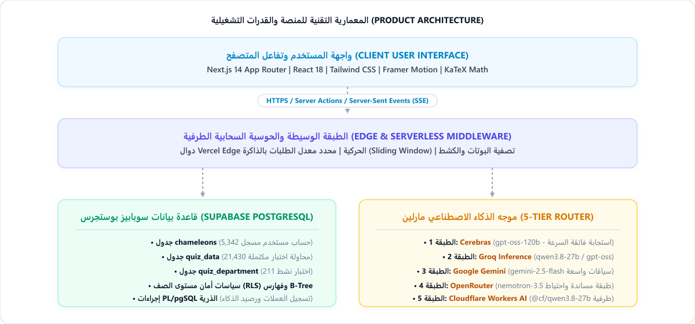
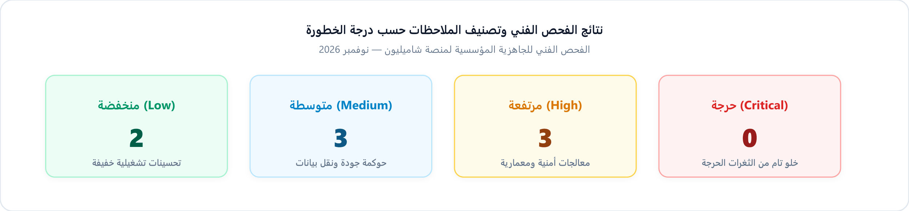
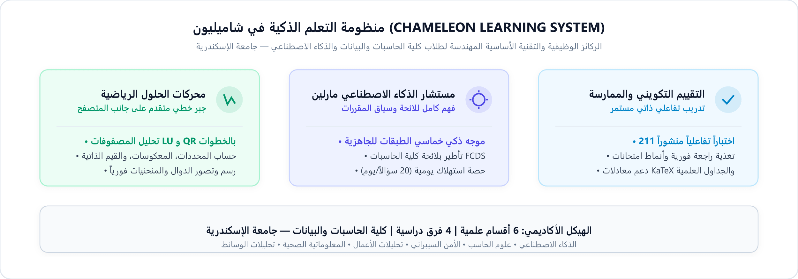

# تقرير الجاهزية المؤسسية لمنصة كاميليون (CHAMELEON)

**نوع الوثيقة:** تقرير تدقيق الجاهزية التقنية والتشغيلية والمؤسسية  
**الجهة المستهدفة:** كلية الحاسبات وعلوم البيانات (FCDS) - جامعة الإسكندرية  
**الجمهور المستهدف:** عميد الكلية، السادة الوكلاء، رؤساء الأقسام، ولجنة التطوير المؤسسي  
**تاريخ اعتماد المؤشرات:** 21 نوفمبر 2026  
**سجل التشغيل الفعلي:** 14 شهراً متواصلاً في الإنتاج (25 سبتمبر 2025 – 21 نوفمبر 2026)  
**نطاق الفحص:** سجلات قاعدة بيانات بوستجرس الميدانية، كود التطبيق، بوابات الربط والتحليلات  

---

## 1. الملخص التنفيذي

منصة **كاميليون (Chameleon)** هي رفيق تعليمي وبيئة تدريب تكويني رقمية مطورة خصيصاً لتتكامل مع لوائح الساعات المعتمدة والبرامج الأكاديمية لكلية الحاسبات وعلوم البيانات بجامعة الإسكندرية.

تعمل المنصة ميدانياً دون انقطاع منذ **25 سبتمبر 2025 (14 شهراً)**، مقدمةً بنوك أسئلة مهيكلة، ومساعداً ذكياً مستنداً للائحة الكلية (مارلين)، وأدوات حوسبة المصفوفات الرياضية من جانب المتصفح.

### مؤشرات التدقيق الميداني المؤكدة (بيانات 21 نوفمبر 2026):
- **5,342 حساب مستخدم مسجل:** موثقة بجدول `chameleons` عبر الدفعات الأربع والخريجين:
  - الفرقة الأولى (مستجدون): **864 حساباً (16.2%)**
  - الطلاب المستمرون (الفرق 2–4): **4,247 حساباً (79.5%)** *(ثانية: 1,673، ثالثة: 1,669، رابعة: 905)*
  - خريجون / معاونو تدريس / غير محدد: **231 حساباً (4.3%)**
- **21,430 محاولة اختبار مكتملة:** موثقة بجدول `quiz_data` عبر **211 اختباراً منشوراً**.
- **1,948 طالباً فريداً:** أنجزوا تدريبات تكوينية كاملة (نسبة وصول وتفاعل **36.5%** من إجمالي المسجلين).
- **ذروة تفاعل الامتحانات:** سجلت حركة الاختبارات قفزات موسمية قياسية في مواسم الامتحانات: **8,288 محاولة في يناير 2026 (نهائي الفصل الأول)**، **5,497 محاولة في نوفمبر 2025 (ميدتيرم)**، و**531 محاولة في نوفمبر 2026**.
- **5.45 مليون رمز ذكاء اصطناعي مستهلك:** موثقة بجدول `CAPI_REQS` عبر 5 طبقات موجهة ومدعومة بلائحة الكلية.
- **تكلفة تشغيل استثنائية:** البنية التحتية الأساسية تكلف حالياً **46.25 إلى 61.25 دولار شهرياً (~2,300 إلى 3,000 جنيه مصري)**.

---

## 2. المعمارية التقنية والقدرات التشغيلية

تعمل المنصة على بنية حوسبة سحابية طرفية بدون خوادم ثابتة، تحقق أقصى استجابة مع غياب أعباء الصيانة:

### الأنظمة التقنية الرئيسية:
1. **واجهة المستخدم:** Next.js 14 (App Router)، React 18، نظام تصميم Material Design 3 (M3)، ومحرك KaTeX لصياغة الرياضيات.
2. **الطبقة الوسيطة:** حوسبة طرفية (Vercel Edge) مع خوارزمية تحديد معدل الطلبات وحجب البوتات.
3. **قاعدة البيانات:** PostgreSQL مدارة عبر سوبابيز، مجهزة بسياسات أمان مستوى الصف (RLS)، وفهارس B-Tree وإجراءات PL/pgSQL ذرية.
4. **موجه الذكاء الاصطناعي (Marline):** موجه خماسي الطبقات (Cerebras → Groq → Google Gemini → OpenRouter → Cloudflare) مع فحص الجاهزية وبث الإجابات عبر SSE.
5. **محرك تدقيق اللائحة الأكاديمية:** ملف `bylaw-retriever.ts` يربط الأسئلة بلائحة كلية FCDS لعدد **206 مقررات**، متطلبات سابقة، والأسماء الشائعة بالعربية والإنجليزية.
6. **محركات الرياضيات والمصفوفات:** تشغيل كامل من جانب المتصفح (`MathEngine.ts` و `MatrixEngine.ts`) لحل المصفوفات وتفكيك LU/QR والقيم الذاتية.

---

## 3. التكامل المؤسسي مع أنظمة الجامعة

صُممت كاميليون لتكون أداة تكاملية تدعم نجاح المنظومة الجامعية ولا تسعى لمنافستها أو استبدالها:

| البُعد | منصات الجامعة الرسمية (SIS / LMS) | منصة كاميليون التكوينية |
|---|---|---|
| **الهدف الأساسي** | إدارة التسجيل الرسمي، إعلان النتائج الرسمية، وحفظ السجلات. | تدريب تكويني يومي، تشخيص نقاط الضعف، وممارسة تفاعلية حرة. |
| **طبيعة التقييم** | تقييمات ختامية رسمية ملزمة (ميدتيرم وفاينال). | تقييمات تدريبية منخفضة الضغط مع شرح وتبرير فوري للخطوات. |
| **الإرشاد الأكاديمي** | ساعات مكتبية محددة مع المرشدين الأكاديميين. | توجيه متواصل 24/7 حول المتطلبات السابقة وبنود اللائحة. |
| **قيمة لعضو التدريس** | رصد الحضور والدرجات النهائية. | لوحات تشخيص مبكرة تكشف المفاهيم الأكثر صعوبة للطلاب قبل الامتحانات. |

---

## 4. نتائج التدقيق التقني والأمني

كشف فحص الكود وقاعدة البيانات عن 8 نقاط مصنفة حسب الأهمية:

| الأهمية | الملاحظة | الأثر | المعالجة الفنية المطلوبة |
|---|---|---|---|
| **مرتفع (HIGH)** | محدد المعدل بالذاكرة المؤقتة | تتعدد بيئات التشغيل السحابية مما يسمح بتجاوز حد الطلبات. | الانتقال إلى خدمة **Upstash Redis** الموزعة. |
| **مرتفع (HIGH)** | تخزين مزدوج لكلمات المرور | تحقق مزدوج عبر `chameleons.pass` وسوبابيز. | توحيد الدخول بنظام الدخول الموحد للجامعة (SSO). |
| **مرتفع (HIGH)** | محاكاة رسومية بلوحة التحكم | استخدام دوال `Math.sin` لرسم المنحنيات عند نقص البيانات. | قصر التقارير على استعلامات التجميع المباشرة من `quiz_data`. |
| **متوسط (MEDIUM)** | خيارات بناء متساهلة | تفعيل `ignoreBuildErrors: true` في إعدادات Next.js. | إلزام الفحص الصارم لجميع أخطاء TypeScript في خط النشر. |
| **متوسط (MEDIUM)** | نطاقات إعلانية في سياسة الأمان | تضمين نطاقات AdSense في سياسة أمان المحتوى (CSP). | قصر النطاقات المسموحة على الروابط الأكاديمية ونماذج الذكاء فقط. |
| **متوسط (MEDIUM)** | تحسين سحب بيانات سوبابيز | استعلامات غير مجزأة قد ترفع استهلاك البيانات في الامتحانات. | إلزام التصفح المجزأ والمفهرس لكافة البيانات التاريخية. |
| **منخفض (LOW)** | دوال استخراج ملفات مهجورة | دوال معالجة غير مستخدمة في ملف `file-processor.ts`. | حذف الملفات غير المفعلة من مستودع الكود. |
| **منخفض (LOW)** | تبعية Google Drive بحسابات مساهمين | مزامنة الملفات تعتمد على رموز مساهمين شخصية. | التحول إلى حساب خدمة رسمي تحت نطاق الجامعة (Service Account). |

---

## 5. نموذج الاستدامة المالية

| الفئة | التكلفة الشهرية (دولار) | التكلفة الشهرية (جنيه مصري) | التفاصيل الفنية |
|---|---|---|---|
| **البنية التحتية الحالية** | **$46.25 – $61.25** | **~2,300 – 3,000 ج.م** | قاعدة بيانات Supabase ($25) + استضافة Vercel ($20) + النطاق ($1.25). |
| **البنية التجريبية المطورة** | **$100.00 – $150.00** | **~4,900 – 7,350 ج.م** | البنية الأساسية + Upstash Redis ($15) + ذكاء اصطناعي مدفوع ($40) + مراقبة ($15). |
| **مكافأة فريق الصيانة (اختيارية)** | *$250.00 – $350.00* | *~12,250 – 17,150 ج.م* | *مكافأة تشجيعية اختيارية للطلاب المطورين (بند إداري منفصل).* |

---

## 6. مقترح التجربة الميدانية المقيدة (ربيع 2027)

يُقترح إطلاق تجربة ميدانية اختيارية مدتها **15 أسبوعاً** على 4 مقررات أساسية بإشراف رؤساء الأقسام:

### مقررات التجربة الاسترشادية:
1. **الجبر الخطي (Linear Algebra)** (`02-24-00101` - متطلب تأسيسي)
2. **برمجة 1 و 2 (Programming I & II)** (`02-24-00105` / `02-24-00110` - مهارة برمجية أساسية)
3. **هياكل البيانات والخوارزميات (Data Structures)** (`02-24-00108` - تخصص مشترك)
4. **نظم قواعد البيانات (Database Systems)** (`02-24-00202` - تخصص مشترك)

### مراحل التنفيذ:
- **الأسبوع 1–2 (تجهيز ومراجعة فنية):** تفعيل Redis ومراجعة منسقي المقررات لبنوك الأسئلة واعتمادها.
- **الأسبوع 3–10 (تدريب تكويني أسبوعي):** حل تدريبات حرة وإرسال تقارير تشخيصية دورية للأساتذة.
- **الأسبوع 11–12 (مراجعة نصف الفصل):** استغلال تقارير الصعوبة لتغطية المفاهيم الشائكة قبل الميدتيرم.
- **الأسبوع 13–14 (مراجعة الامتحانات النهائية):** إتاحة نماذج تدريبية واستطلاع آراء الطلاب وأعضاء التدريس.
- **الأسبوع 15 (التقرير الختامي):** عرض نتائج التجربة على مجلس الكلية.

### مؤشرات النجاح المستهدفة:
- **تفعيل الدفعة:** مشاركة ≥ 50% من طلاب المقررات في حل اختبارين تكوينيين على الأقل شهرياً.
- **كثافة الممارسة:** إنجاز ≥ 1,500 اختبار تكويني شهرياً في المقررات الأربعة.
- **تسليم تقارير التشخيص:** التزام 100% بتسليم تقارير الصعوبة الموجهة لمنسقي المقررات.
- **رضا المستفيدين:** تحقيق ≥ 75% تقييم إيجابي في استطلاعات نهاية الفصل.

---

## 7. حوكمة البيانات والضمانات القانونية

1. **قانون حماية البيانات الشخصية المصري رقم 151 لسنة 2020:** تُعد كلية FCDS **المتحكم في البيانات (Data Controller)** وفريق المنصة **معالجاً للبيانات (Data Processor)**.
2. **ملكية البيانات:** جامعة الإسكندرية هي المالك الوحيد لكافة السجلات الأكاديمية وإحصائيات الطلاب، مع حظر كامل لأي استغلال تجاري أو إعلاني.
3. **الملكية الفكرية:** يحتفظ المطورون بملكية الكود المصدري مع منح كلية FCDS رخصة تشغيل تعليمية غير حصرية ومجانية طوال فترة الشراكة.
4. **حدود الذكاء الاصطناعي:** مخرجات مارلين استرشادية بحتة ولا تُعتبر قرارات إدارية أو موافقات رسمية على التخرج أو التسجيل.

---

## 8. التوصية الاستراتيجية وخطة العمل

بدلاً من الدخول في تعاقدات تجارية باهظة أو استهلاك 9–12 شهراً وميزانيات تصل إلى 600 ألف إلى مليون جنيه في تطوير نظام بديل، توصي الدراسة بنهج تدريجي واقعي:

1. **الخطوة 1: عرض تقديمي ومناقشة فنية:** استعراض القدرات التشغيلية أمام قيادات الكلية.
2. **الخطوة 2: تشكيل لجنة مراجعة مشتركة:** تضم عضوين من هيئة التدريس وممثلاً عن وحدة تكنولوجيا المعلومات.
3. **الخطوة 3: اعتماد التجربة المقيدة لربيع 2027:** تطبيق التجربة على المقررات الأربعة المختارة.
4. **الخطوة 4: تقييم مخرجات التجربة:** قياس التفاعل الفعلي وأثره على التحصيل في نهاية الفصل.
5. **الخطوة 5: بحث أفق التكامل الدائم:** استكشاف الربط مع نظام الدخول الموحد (SSO) واستضافة الكلية.

**التوصية الحالية:** الموافقة على الخطوة الأولى وتشكيل لجنة المراجعة المشتركة.
