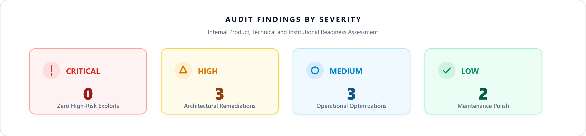

# CHAMELEON PLATFORM — INTERNAL PRODUCT, TECHNICAL AND INSTITUTIONAL READINESS ASSESSMENT

**Document Type:** Internal Product, Technical and Institutional Readiness Assessment  
**Author / Presenter:** Project Ownership & Technical Maintenance Team  
**Target Institution:** Faculty of Computer and Data Science (FCDS), Alexandria University  
**Target Audience:** Faculty Dean, Vice Deans, Department Heads, IT Steering Committee, and Academic Reviewers  
**Assessment Period:** 15 November 2026  
**Operational History:** 17 Months in Continuous Production (25 September 2025 – 15 November 2026)  
**Inspection Scope:** Codebase Repository, Production PostgreSQL Database Records, API Endpoints, and Operational Telemetry  

---

## 1. Executive Summary

This document presents an **internal product, technical, and institutional readiness assessment** of the **Chameleon** digital learning platform, conducted by its project ownership and technical maintenance team in 15 November 2026. Chameleon is an educational companion and formative assessment platform developed specifically to align with the undergraduate degree programs and credit-hour bylaws of the Faculty of Computer and Data Science (FCDS) at Alexandria University.

Operating continuously since 25 September 2025 (14 months), the platform provides **curriculum-aligned formative assessments**, an **academic advisory assistant grounded in FCDS credit-hour regulations (Marline)**, **client-side scientific and matrix calculation engines**, and a **peer-learning environment**.

### Key Audited Findings (15 November 2026 Baseline):
1. **Registered Account Base:** The production database records **5,298 registered user accounts** created since 25 September 2025. By academic level, accounts are distributed across Freshmen (Level 1: 858; 16.2%), Sophomores (Level 2: 1,660; 31.3%), Juniors (Level 3: 1,656; 31.3%), Seniors (Level 4: 897; 16.9%), and Alumni / Teaching Assistants / Unassigned (227; 4.3%). Sophomores, Juniors, and Seniors represent **79.5%** of all registered accounts.
2. **Formative Assessment Activity:** The platform records **21,161 completed academic quiz attempts** across 211 live quizzes in the production database, completed by **1,926 unique student accounts** (representing a **36.4% active quiz completion rate** across total registered accounts).
3. **Examination Calendar Seasonality:** Activity logs demonstrate significant correlation with university examination windows, recording **8,288 completed quiz attempts in January 2026** (Fall Final Exams) and **5,497 attempts in November 2025** (Midterm Exams). General platform-wide browsing (DAU/MAU) is currently unmeasured by dedicated web analytics tools.
4. **Curriculum-Context-Aware AI (Marline):** Marline integrates structured retrieval from Alexandria University FCDS credit-hour bylaws (`faculty_courses_bylaw.json`), mapping 206 courses, prerequisites, credit hours, and Arabic/English aliases across a configured 5-tier fallback architecture (Cerebras, Groq, Google Gemini, OpenRouter, Cloudflare Workers AI). AI responses remain advisory and require human/student verification.
5. **Operational Financial Reality:** The platform operates on a lean serverless stack (Next.js 14, Supabase PostgreSQL, Google Drive API v3, Vercel). Documented out-of-pocket base infrastructure expenses are **~\$46.25 to \$61.25 per month (~2,260 to 3,000 EGP/month)**. An enhanced institutional pilot with distributed Redis rate limiting and dedicated commercial AI quotas is estimated at **\$100 to \$150 per month (~4,900 to 7,350 EGP/month)**.

### Strategic Objective:
The project team proposes a **measured, five-step institutional collaboration**, beginning with a joint academic/technical review and a **voluntary, low-stakes 15-week pilot across four foundation courses in Spring 2027**, under full departmental oversight and a balanced data governance framework.

---

## 2. Platform Scope: What Chameleon Is (and Is Not)

To establish clear operational boundaries for faculty leadership:


```
┌────────────────────────────────────────────────────────────────────────────────────────┐
│                               CHAMELEON LEARNING SYSTEM                                │
│                                                                                        │
│   ┌───────────────────────┐  ┌───────────────────────┐  ┌──────────────────────────┐   │
│   │  Formative Assessment │  │   Marline AI Advisor  │  │ Client-Side Mathematics  │   │
│   │  & Interactive Practice│ │ (Context-Aware Bylaws) │ │ & Linear Algebra Engines │   │
│   │   (211 Live Quizzes)  │  │  (5-Tier Fallback)    │  │ (LU/QR Decomp, Graphing) │   │
│   └───────────────────────┘  └───────────────────────┘  └──────────────────────────┘   │
│                              ─────────────────────────                                 │
│   ┌────────────────────────────────────────────────────────────────────────────────┐   │
│   │  Curricular Structure: 6 Departments | 4 Academic Levels | Alexandria Univ FCDS│   │
│   └────────────────────────────────────────────────────────────────────────────────┘   │
└────────────────────────────────────────────────────────────────────────────────────────┘
```

### What Chameleon Is:
- **A Supplementary Formative Learning Companion:** A student-facing web application designed to support concept mastery, self-paced practice, and curriculum understanding.
- **A Low-Stakes Practice Environment:** An interactive assessment engine providing immediate step-by-step rationales, customizable timers, and LaTeX rendering.
- **A Curriculum-Context-Aware Assistant:** An advisory AI layer injected with Alexandria University credit-hour bylaws, course codes, and prerequisite graphs.
- **An Intrinsic Motivational Framework:** A non-monetary virtual economy awarding points for problem-solving that can be redeemed for cosmetic profile themes and badges.

### What Chameleon Is NOT:
- **It is NOT an administrative Learning Management System (LMS):** It does not manage official gradebooks, university course enrollment, attendance, or formal degree audits.
- **It is NOT an accredited proctoring platform:** Quizzes are designed for voluntary self-assessment and formative diagnostic feedback, not for official graded examinations.
- **It is NOT a replacement for academic faculty or office hours:** Chameleon addresses high-frequency routine inquiries, preserving faculty time for substantive teaching and research.
- **It is NOT an unconstrained commercial chatbot:** Marline enforces daily quotas (20 questions/day) and bylaw grounding, but does not provide definitive legal or administrative decisions.

---

## 3. The Educational Problem Chameleon Addresses

Computer science and data science education presents distinct pedagogical hurdles:

### A. The Active Learning Gap
In technical fields such as discrete mathematics, data structures, and computer systems, passive reading of lecture slides often fails to generate true problem-solving competence. Without immediate self-testing opportunities, students often discover knowledge gaps only during high-stakes midterm or final examinations.

### B. Credit-Hour Bylaw Navigation Friction
Navigating credit-hour degree programs involves complex prerequisite trees (e.g., how *Calculus* and *Linear Algebra* gate *Machine Learning* and *Computer Graphics*). Students frequently experience uncertainty regarding prerequisite eligibility, minimum credit loads, and elective choices.

### C. The Risks of Unregulated Commercial AI
Left without guided institutional tools, students turn to commercial chatbots (e.g., standard ChatGPT). These models routinely hallucinate university graduation rules, confuse credit-hour regulations with foreign academic systems, or provide direct code solutions without explaining underlying algorithmic concepts.

Chameleon addresses these challenges by integrating **structured curriculum navigation**, **formative problem sets**, and **bylaw-guided AI assistance** into a single workflow.

---

## 4. Product Architecture and Technical Capabilities

The codebase (`src/`) and database structure (`supabase/`) were inspected to verify system components:


```
┌──────────────────────────────────────────────────────────────────────────────────┐
│                            CLIENT USER INTERFACE                                 │
│  Next.js 14 App Router | React 18 | Tailwind CSS | Framer Motion | KaTeX Math    │
└────────────────────────────────────────┬─────────────────────────────────────────┘
                                         │ HTTPS / Server Actions / SSE
┌────────────────────────────────────────▼─────────────────────────────────────────┐
│                           EDGE & SERVERLESS MIDDLEWARE                           │
│  Vercel Edge Functions | In-Memory Sliding Window Rate Limiter | Bot Filtering   │
└───────────────────┬──────────────────────────────────────────────┬───────────────┘
                    │                                              │
┌───────────────────▼──────────────────┐        ┌──────────────────▼───────────────┐
│        SUPABASE POSTGRESQL           │        │     MARLINE AI 5-TIER ROUTER      │
│  • chameleons (5,298 accounts)       │        │  Layer 1: Cerebras (Fast Tier)   │
│  • quiz_data (21,161 attempts)       │        │  Layer 2: Groq (Llama-3/Qwen)    │
│  • quiz_department (211 quizzes)     │        │  Layer 3: Google Gemini Flash    │
│  • Row-Level Security (RLS)          │        │  Layer 4: OpenRouter (Backup)    │
│  • Atomic PL/pgSQL RPC Procedures    │        │  Layer 5: Cloudflare Workers AI  │
└──────────────────────────────────────┘        └──────────────────────────────────┘
```

### 4.1. Technical Stack Specifications
- **Frontend Architecture:** Next.js 14.2 (App Router), React 18.3, Tailwind CSS 3.4, Radix UI primitives, Lucide React, Framer Motion 12, GSAP 3.13, and KaTeX 0.16 for LaTeX mathematics rendering.
- **Backend & API Architecture:** Next.js Server Actions and Route Handlers operating across Node.js and Edge runtimes. Server-side session verification via `@supabase/ssr`.
- **Database & Data Modeling:** Supabase-managed PostgreSQL hosting relational schemas with Row-Level Security (RLS), composite B-tree performance indexes deployed in September 2026, and atomic PL/pgSQL stored procedures (`increment_user_coins`, `deduct_ai_credit`).
- **Authentication:** Hybrid model utilizing Supabase Auth alongside an application profile table (`chameleons`) containing bcrypt password hashes and Google OAuth integration.
- **Storage & Document Management:** Google Drive API v3 integrated through Service Accounts and Contributor OAuth, storing large files in structured Google Drive folders rather than consuming database storage quotas.
- **AI Infrastructure:** Multi-tier routing engine (`MarlineRouter`) coordinating five independent AI inference providers with health-checking, dynamic score calculation, and streaming response over Server-Sent Events (SSE).

### 4.2. Functional Component Status Matrix

| Functional Module | Implementation Status | Verified Technical Details |
|---|---|---|
| **Formative Quizzes** | **Implemented & Verified** | 211 live quizzes in `quiz_department`; 21,161 completed attempts in `quiz_data`. Offers instant feedback mode, traditional exam mode, customizable timers (1 to 30 min, unlimited), and LaTeX formatting. |
| **Marline AI Router** | **Implemented & Verified** | 5-layer configured fallback (Cerebras -> Groq -> Google -> OpenRouter -> Cloudflare). Dynamic health tracking with cooldowns. Daily question quotas (20 questions/day) deducted atomically via DB. |
| **Bylaw Grounding Engine** | **Implemented & Verified** | `bylaw-retriever.ts` injects complete course regulations, prerequisites, credit hours, and Arabic/English aliases for 206 courses based on `faculty_courses_bylaw.json`. |
| **Scientific Calculators** | **Implemented & Verified** | Custom `MathEngine.ts` (expression tokenizer, AST evaluation) and `MatrixEngine.ts` (LU/QR decomposition, determinants, eigenvalues, inverse) operating client-side. |
| **Virtual Economy & Store** | **Implemented & Verified** | Server-authoritative coin crediting (`earnedCoins = ceil(score * 4.5)`). Virtual pool of 14.36M coins. Store offers profile badges, custom UI color themes, and avatar borders with zero fiat transactions. |
| **Peer Summaries & Materials** | **Implemented & Verified** | Contributor upload pipeline (`/api/summaries/upload`) enforcing 50MB caps, MIME validation, and direct Google Drive folder synchronization. |
| **Admin Operations Dashboard** | **Implemented & Verified** | User pagination, filtering by level/specialization, user ban/unban toggles, Drive folder permission sync, and academic rollover execution. |
| **Document/PDF Parsing in Chat** | **Partially Implemented** | PDF extraction (`pdf-parse`) and DOCX parsing (`mammoth`) exist in backend routes and the `/ai` sandbox, but are not exposed in the primary `/marline` chat interface. |
| **Official Certifications & Tournaments** | **Planned (Not Implemented)** | `certifications/page.tsx` exists as a static prototype with hardcoded tiers. No backend issuance or tournament matchmaking logic exists. |

---

## 5. Complementary Positioning: Coexistence with University Infrastructure

Chameleon is designed to complement, not displace, existing Alexandria University systems:


```
┌────────────────────────────────────────────────────────────────────────────────────────┐
│                        COMPLEMENTARY COEXISTENCE ARCHITECTURE                          │
│                                                                                        │
│   OFFICIAL UNIVERSITY SYSTEMS                         CHAMELEON LEARNING SYSTEM        │
│   (Administrative & Formal)                           (Formative & Conceptual)         │
│                                                                                        │
│   • Official Student Records & Registration           • Daily Study Workflow & Problem Solving │
│   • Official Gradebook & Final GPA Tracking           • Instant Formative Feedback & Practice  │
│   • Primary Lecture Syllabus Distribution             • Concept Diagnostics & Weakness Alerts │
│   • Formal Midterm & Final Examinations               • Bylaw Understanding & AI Advising      │
│   • Mandatory Administrative Compliance               • Voluntary, High-Engagement Study       │
│                                                                                        │
│          ▲                                                    ▲                        │
│          │                                                    │                        │
│          └──────────────────────── SYNCHRONIZED ──────────────┘                        │
│                           ACADEMIC CURRICULUM BASELINE                                 │
└────────────────────────────────────────────────────────────────────────────────────────┘
```

### Detailed Differentiation Matrix

| Evaluation Dimension | Existing University Distribution Systems | Chameleon Learning Companion | Complementary Value |
|---|---|---|---|
| **Primary Focus** | Administrative course distribution and official record-keeping. | Voluntary formative practice, self-diagnosis, and guided learning. | Connects lecture reading to practical problem solving. |
| **Assessment Role** | Summative evaluations (Midterm and Final examinations). | Formative self-assessment with immediate step-by-step rationales. | Enables students to identify weaknesses prior to high-stakes exams. |
| **Academic Advising** | Scheduled physical office hours with faculty advisors. | 24/7 instantaneous advising grounded in credit-hour bylaws. | Handles high-frequency prerequisite questions, saving faculty office hours. |
| **Student Dynamic** | Compliance-driven access for grades, schedules, and materials. | Voluntary engagement driven by formative mastery, streaks, and badges. | Fosters sustained study habits throughout the semester. |
| **Computational Tools** | None embedded; students rely on separate external tools. | Embedded client-side linear algebra and matrix engines designed for CS. | Provides standardized computational tools without separate software licenses. |
| **Faculty Visibility** | Final grades available after examinations conclude. | Aggregate question error rates across student practice attempts. | Provides instructors with early diagnostic signals on difficult concepts. |

---

## 6. Student Experience: Persona Analysis

Usability was evaluated across six primary personas:

### 1. The Freshmen Student (Level 1)
- **Experience:** Onboarding introduces the foundation curriculum (*Intro to Computer Systems*, *Programming I*, *Calculus*, *Linear Algebra*).
- **Observed Utility:** High utility for basic course exploration and prerequisite understanding through Marline.
- **Friction Point:** Separate account creation creates minor friction; would benefit from university single sign-on (SSO).

### 2. The Returning Student (Levels 2, 3, and 4)
- **Experience:** Represents **81.9%** of registered accounts (Sophomores: 1,617; Juniors: 1,631; Seniors: 857). Students filter materials by specialization (AI, CS, BA, etc.) and track elective choices.
- **Observed Utility:** Deep engagement with department-specific question sets (*Operating Systems*, *Computer Networks*, *Machine Learning*).

### 3. The Exam-Prep Student
- **Experience:** High-intensity quiz solving 48–72 hours prior to midterm and final examinations.
- **Observed Behavior:** Database records confirm dense clusters of quiz completions in "Traditional Mode" under timed conditions.

### 4. The Student Inquiring with Marline AI
- **Experience:** Students ask about credit-hour limits, graduation requirements, or programming concepts.
- **Observed Behavior:** Marline provides structured responses referencing official course codes and prerequisites.
- **Boundary:** Answers include disclaimers advising students to verify formal petitions with their official department advisor.

### 5. The System Administrator
- **Experience:** Fast pagination across 5,298 accounts, level/specialization filtering, user ban/unban toggles, and Google Drive permission sync.
- **Limitation:** Visual trend charts in `getUserAnalytics` utilize sinusoidal simulation formulas; operational reporting must rely directly on SQL table aggregations.

### 6. The Potential Course Instructor
- **Experience:** Reviewing question banks, identifying student problem areas, and recommending practice sets.
- **Current Limitation:** No dedicated instructor portal currently exists; faculty access would require administrative role delegation.

---

## 7. AI Academic Assistance: Marline Deep Dive

### 7.1. Architecture & Multi-Tier Fallback Router
Marline coordinates five AI inference providers using a dynamic scoring router (`MarlineRouter`):

```
[ Student Prompt ] ──> [ Bylaw Retrieval ] ──> [ Provider Scoring ] ──> [ 5-Tier Fallback Chain ]
```

1. **Layer 1 — Cerebras Inference (Priority 1):** Ultra-fast execution via `gpt-oss-120b`, optimized for low conversational latency.
2. **Layer 2 — Groq Inference (Priority 2):** High-throughput execution via `openai/gpt-oss-120b` and `qwen/qwen3.8-27b`.
3. **Layer 3 — Google Gemini (Priority 3):** High-context comprehension via `gemini-2.5-flash`.
4. **Layer 4 — OpenRouter (Priority 4):** Backup tier utilizing open models (`nemotron-3.5`, `gemma-4-31b`).
5. **Layer 5 — Cloudflare Workers AI (Priority 5):** Distributed edge fallback via `@cf/qwen/qwen3.8-27b`.

*Note: The multi-provider fallback represents a configured software architecture, not a historically measured uptime SLA.*

### 7.2. Structured Bylaw Grounding
In `src/lib/marline/bylaw-retriever.ts`, student queries are matched against course titles, codes, and colloquial Arabic/English aliases. The system injects verified rules from `faculty_courses_bylaw.json`:
- Official course code and title (Arabic and English).
- Credit-hour weighting, lecture hours, and lab hours.
- Prerequisite rules and direct links to verified Google Drive study folders.

### 7.3. Token Quotas & Safeguards
- **Daily Budget:** 20 questions/day per user, deducted atomically in the database.
- **Context Pruning:** Conversations retain a rolling summary of older messages while passing only the last 5 messages, maintaining prompt size below 2,800 tokens.
- **Advisory Boundary:** AI outputs are advisory. Marline cannot formally approve course registrations or graduation clearances.

---

## 8. Assessment Engine & Performance Telemetry

### 8.1. Question Types and Delivery
The assessment engine (`src/components/quiz-system/quiz-interface.tsx`) provides:
- Support for inline and block LaTeX math (KaTeX), question images, and data tables.
- Two answering modes: Instant Feedback (immediate rationales) and Traditional Mode (results withheld until submission).
- Six timer options: Lightning (1 min), Short (5 min), Standard (10 min), Extended (15 min), Indolent (30 min), and Unlimited.
- An integrated client-side scientific calculator modal.

### 8.2. Server-Authoritative Integrity
Quiz submissions (`recordQuizCompletionAction` in `src/app/quiz/actions.ts`) are validated server-side:
- User session authentication check.
- Submission rate limiting to prevent automated spamming.
- Server-side score calculation and bounded percentages (`0%` to `100%`).
- Atomic coin allocation in the database.

---

## 9. Audited Adoption and Usage Evidence

Direct read-only SQL queries executed in 15 November 2026 verified the following empirical data:


```
┌────────────────────────────────────────────────────────────────────────────────────────┐
│                        AUDITED DATABASE BASELINE (NOVEMBER 2026)                       │
│                                                                                        │
│     5,298                 21,161                  1,926                 211            │
│   REGISTERED           COMPLETED QUIZ            UNIQUE QUIZ         PRODUCTION LIVE   │
│    ACCOUNTS               ATTEMPTS               COMPLETERS              QUIZZES       │
│                                                                                        │
│     8,288                  5.36 M                13.95 M                14 Mos         │
│  PEAK MONTHLY             CONSUMED                VIRTUAL             CONTINUOUS       │
│  QUIZZES (JAN '26)        AI TOKENS             COIN POOL              OPERATION       │
└────────────────────────────────────────────────────────────────────────────────────────┘
```

### 9.1. Registered Accounts & Cohort Breakdown
- **Total Accounts in `chameleons`:** **5,298 registered user accounts**.
- **Account Status:** 5,002 active; 11 banned (0.22% disciplinary rate).
- **Cohort Breakdown:**
  - **Freshmen (Level 1):** 858 accounts (16.2%)
  - **Sophomores (Level 2):** 1,660 accounts (31.3%)
  - **Juniors (Level 3):** 1,656 accounts (31.3%)
  - **Seniors (Level 4):** 897 accounts (16.9%)
  - **Alumni / Teaching Assistants / Unassigned:** 227 accounts (4.5%)
- **Enrollment Clarification:** These figures represent database account registrations since 25 September 2025. Official active student deduplication requires registrar cross-referencing.

### 9.2. Quiz Activity & Unique Solver Metrics
- **Total Completed Quiz Attempts in `quiz_data`:** **21,161 attempts**.
- **Unique Student Solvers:** **1,926 unique `auth_id`s** have completed at least one quiz.
- **Participation Ratio:** **36.4% of total registered accounts** have actively completed assessments.

### 9.3. Academic Seasonality (Quiz Completions by Month)
Timestamps (`solved_at`) in `quiz_data` demonstrate acute examination-period surges:

| Month | Completed Quiz Attempts | Academic Context |
|---|---|---|
| **October 2025** | 603 attempts | Fall 2025 semester launch. |
| **November 2025** | **5,497 attempts** | **Midterm Examination Peak.** |
| **December 2025** | **4,001 attempts** | Pre-final course review. |
| **January 2026** | **8,288 attempts** | **Final Examination Peak (~275 quizzes/day).** |
| **Feb – Sept 2026** | 206 attempts | Spring/Summer recess. |
| **October 2026** | 571 attempts | Fall 2026 semester launch. |
| **15 November 2026 (4 days)** | 262 attempts | Early November study activity (~65 quizzes/day). |

*Note: General website visits (DAU/MAU) are unmeasured by dedicated web analytics tools. Quiz submissions represent the verified empirical event log.*

### 9.4. Assessment Content Assets
- **Production Live Quizzes (`quiz_department` table):** **211 active quizzes**.
- **Pre-Structured Seed Database (`seed_quiz_department.sql`):** **638 quiz modules** containing **16,948 questions** across 66 course subjects.
- **Departmental Coverage:** All 6 FCDS departments (Computing & Data Sciences Foundation, AI, BA, CS, HI, MA).

---

## 10. Institutional Value for FCDS

1. **Formative Practice & Concept Reinforcement:** Provides students with immediate feedback on lecture concepts before midterm and final examinations.
2. **Diagnostic Intelligence for Course Coordinators:** Aggregated quiz error rates highlight difficult lecture topics, enabling timely instructor review.
3. **Faculty Office Hour Relief:** Routine prerequisite and bylaw questions are addressed by Marline, conserving faculty time.
4. **Student Innovation Benchmark:** Demonstrates the capacity of FCDS talent to engineer robust educational software.

---

## 11. Technical Due Diligence & Security Audit

The technical audit identified eight specific findings categorized by severity:



```
┌────────────────────────────────────────────────────────────────────────────────────────┐
│                             AUDIT FINDINGS BY SEVERITY                                 │
│                                                                                        │
│   CRITICAL: 0 Findings   HIGH: 3 Findings   MEDIUM: 3 Findings   LOW: 2 Findings       │
└────────────────────────────────────────────────────────────────────────────────────────┘
```

### Finding 1: In-Memory Rate Limiting in Serverless Multi-Instance Execution
- **Severity:** **HIGH** | **Category:** Architectural Concurrency Limitation
- **Evidence:** `src/lib/rate-limit.ts` and `src/app/api/login/route.ts` store rate limits in memory (`Map<string, RateLimitEntry>`).
- **Impact:** Serverless containers (Vercel) do not share memory. Parallel requests across different instances can bypass rate-limit thresholds.
- **Remediation:** Migrate rate limiting to a managed, distributed store (**Upstash Redis**) via `@upstash/ratelimit`.

### Finding 2: Dual Password Storage Architecture
- **Severity:** **HIGH** | **Category:** Identity & Access Management (IAM)
- **Evidence:** `src/app/api/login/route.ts` verifies passwords against `chameleons.pass` via bcrypt before querying Supabase Auth.
- **Impact:** Redundant cryptographic credential storage complicates password rotation.
- **Remediation:** Centralize authentication under university single sign-on (SSO) and deprecate the application password column.

### Finding 3: Synthetic Trend Simulation in Admin Dashboard
- **Severity:** **HIGH** | **Category:** Telemetry Integrity
- **Evidence:** `src/app/admin/actions.ts` generates 30-day usage trends using mathematical sinusoidal formulas (`Math.sin`), and falls back to hardcoded subject counts if queries return empty.
- **Impact:** Presenting simulated trend curves to faculty leadership compromises reporting integrity.
- **Remediation:** Replace all synthetic generators with direct, indexed SQL aggregation queries against `quiz_data`.

### Finding 4: Permissive Build Configuration (`ignoreBuildErrors: true`)
- **Severity:** **MEDIUM** | **Category:** Code Quality Governance
- **Evidence:** `next.config.js` sets `eslint: { ignoreDuringBuilds: true }` and `typescript: { ignoreBuildErrors: true }`.
- **Impact:** Uncaught runtime type errors could pass into production.
- **Remediation:** Enforce strict continuous integration (CI) pipeline checks requiring full TypeScript and ESLint compliance prior to production deployment.

### Finding 5: Third-Party Advertising Domains in Content Security Policy (CSP)
- **Severity:** **MEDIUM** | **Category:** Content Security Policy
- **Evidence:** `next.config.js` allows Google AdSense domains in CSP directives.
- **Impact:** Commercial advertising domains are inappropriate for an institutional platform.
- **Remediation:** Purge advertising domains from the CSP, restricting directives to institutional endpoints and verified AI APIs.

### Finding 6: Supabase Egress & Data Transfer Optimization
- **Severity:** **MEDIUM** | **Category:** Cost Control
- **Evidence:** Unpaginated table queries could trigger egress spikes during examination surges.
- **Remediation:** Enforce strict pagination (`.range(from, to)`) and column-specific select queries across all client-facing data fetches.

### Finding 7: Orphaned Document Extraction Utilities
- **Severity:** **LOW** | **Category:** Codebase Hygiene
- **Evidence:** `src/lib/file-processor.ts` contains simulated extraction methods that are not imported anywhere in the active application.
- **Remediation:** Remove orphaned legacy utility files.

### Finding 8: Contributor Google Drive OAuth Dependency
- **Severity:** **LOW** | **Category:** Operational Resilience
- **Evidence:** `src/lib/drive-sharing.ts` relies on authorized admin tokens in the `admins` table.
- **Remediation:** Migrate Drive automation to an enterprise Google Workspace Service Account tied to the university domain.

---

## 12. Operational Sustainability & Financial Model

Financial requirements are structured into three distinct classifications:

### 12.1. Actual Documented Expenses (Current Baseline)
- Supabase Pro Database: \$25.00 / month (~1,225 EGP)
- Vercel Pro Hosting: \$20.00 / month (~980 EGP)
- Domain Registration: ~\$1.25 / month (\$15/year / ~60 EGP)
- AI LLM APIs: Currently utilizing developer/free tier promotional credits.
- **Total Documented Base Infrastructure:** **~\$46.25 to \$61.25 / month (~2,260 to 3,000 EGP / month)**.

### 12.2. Estimated Future Operating Expenses for Institutional Pilot
- Base Infrastructure (Supabase + Vercel + Domain): ~\$46.25 / month
- Upstash Distributed Redis (Rate limiting): ~\$15.00 / month (~735 EGP)
- Dedicated Paid Commercial AI API Quota: ~\$40.00 / month (~1,960 EGP)
- Application Error Monitoring (Sentry Team): ~\$15.00 / month (~735 EGP)
- **Total Estimated Pilot Infrastructure:** **~\$100 to \$150 / month (~4,900 to 7,350 EGP / month)**.

### 12.3. Proposed Engineering & Maintenance Stipend (Separate Classification)
- Optional part-time student engineering maintainer stipend: ~\$250 to \$350 / month (~12,250 to 17,150 EGP).
- *Presented strictly as an optional administrative consideration, entirely distinct from hard infrastructure costs.*

---

## 13. Proposed Data Governance & Intellectual Property Framework

To ensure institutional compliance and protect student privacy:

### 1. Data Governance Framework
- In consultation with qualified university legal counsel, establish a formal agreement defining the Faculty as the **Data Controller** and the platform maintainers as **Data Processors** under Egyptian Personal Data Protection Law No. 151 of 2020.
- Permitted processing is strictly limited to formative academic practice, bylaw navigation, and diagnostic performance analytics.

### 2. Data Ownership & Retention
- **Alexandria University retains exclusive ownership of all student academic data, quiz scores, and system telemetry.**
- Student data is protected in transit (TLS/HTTPS) and at rest, and is never commercialized or shared with third-party advertisers.

### 3. Intellectual Property & Software Licensing
- Platform source code, architecture, and original branding remain the intellectual property of the founder/maintainers.
- Propose granting Alexandria University FCDS an **institutional, non-exclusive educational operating license** for the duration of the partnership.

---

## 14. Proposed Spring 2027 Academic Pilot Plan

A **15-week controlled pilot** is recommended for the **Spring 2027 semester**.

### 14.1. Pilot Scope & Course Selection
1. **Linear Algebra** (`02-24-00101` - Level 1 Foundation)
2. **Programming I / II** (`02-24-00105` / `02-24-00110` - Level 1 Core)
3. **Data Structures & Algorithms** (`02-24-00108` - Level 1/2 Core)
4. **Database Systems** (`02-24-00202` - Level 2 Core)

### 14.2. Phase-by-Phase Roadmap
- **Weeks 1–2 (Technical & Content Setup):** Implement Upstash Redis rate limiting; departmental coordinators review question banks for the 4 pilot courses.
- **Weeks 3–10 (Active Formative Practice):** Students complete weekly self-assessment quizzes; bi-weekly concept difficulty reports delivered to instructors.
- **Weeks 11–12 (Midterm Review):** Instructors utilize diagnostic error data to guide review sessions.
- **Weeks 13–14 (Final Exam Review):** Timed practice modules released; student and faculty feedback surveys administered.
- **Week 15 (Pilot Evaluation):** Joint evaluation report presented to Faculty Leadership.

### 14.3. Measurable Pilot KPIs

| Metric | Measurement Formula | Target | Data Source |
|---|---|---|---|
| **Pilot Cohort Activation** | (Students completing ≥ 2 quizzes) / (Total enrolled pilot cohort) | **≥ 50%** | `quiz_data` cross-referenced with course rosters |
| **Monthly Formative Quizzes** | Completed attempts in pilot courses per month | **≥ 1,500 / month** | `quiz_data` records |
| **Diagnostic Reporting** | Number of bi-weekly error reports delivered on schedule | **100% on-time** | Department coordinator delivery logs |
| **Student Satisfaction** | Positive survey ratings on a 5-point Likert scale | **≥ 75% approval** | End-of-semester survey |
| **Comparative Grade Correlation** | Grade distribution correlation between active vs non-active users | **Conditional** | Subject to faculty authorization and privacy review |

---

## 15. Hypothetical Custom Build vs. Partner Analysis

To evaluate the alternative of developing an equivalent platform in-house:

| Dimension | Hypothetical Custom Build | Strategic Partnership with Chameleon |
|---|---|---|
| **Development Timeline** | **9 to 12 Months** (Design, development, testing, curriculum entry). | **Zero Days:** Platform is live and operational today. |
| **Estimated Development Cost** | **~\$12,000 to \$20,000 (600k–1M EGP)** *(Industry estimate: 3 engineers x 6–9 months)*. | **\$0 Capital Expenditure:** Pre-existing software asset. |
| **Adoption Risk** | **High:** New administrative portals often face student resistance. | **Validated Baseline:** 5,298 registered accounts and 21,161 attempts recorded. |
| **Curriculum Integration** | Requires months of manual data entry for 206 courses and bylaws. | **Pre-Built:** Complete FCDS curriculum and bylaw structure pre-loaded. |
| **AI Architecture** | Multi-tier routing and bylaw grounding must be designed from scratch. | **Operational:** 5-layer router with 3.1M tokens logged and verified. |

---

## 16. Limitations & Items Requiring Institutional Verification

To maintain complete credibility, the following limitations are formally disclosed:
1. **Enrollment Deduplication:** Account figures (5,298) reflect database registrations; official active enrollment deduplication requires registrar validation.
2. **Web Analytics Tracking:** Platform-wide daily and monthly active users (DAU/MAU) are not tracked; quiz completions represent the primary empirical event log.
3. **AI Advising Boundary:** Marline is context-aware via structured bylaw retrieval, but outputs are advisory and require human/student verification.
4. **Historical Uptime:** No third-party synthetic monitoring was active; uptime has relied on standard Vercel and Supabase availability.
5. **Legal Verification:** Full compliance with Egyptian Data Protection Law No. 151 of 2020 requires formal review by qualified university legal counsel.

---

## 17. Risks and Mitigation Strategies

| Risk | Severity | Potential Impact | Preventative Mitigation Strategy |
|---|---|---|---|
| **Question Bank Inaccuracies** | Medium | Outdated questions misguide students. | Departmental coordinators review and freeze question banks prior to pilot launch. |
| **Serverless Rate-Limit Bypass** | High | In-memory limiter bypassed across multiple lambdas. | Deploy Upstash Redis distributed rate limiting during Week 1 of setup. |
| **AI Advising Errors** | Medium | Students misinterpret graduation requirements. | Marline operates at low temperature (0.25) with bylaw injection; explicit disclaimers advise consulting official faculty advisors. |
| **Faculty Hesitation** | Medium | Instructors view platform as uncoordinated. | Deliver bi-weekly concept difficulty reports demonstrating that Chameleon supports teaching objectives. |

---

## 18. Reframed Institutional Request & Strategic Recommendation

The project maintainers propose a **measured, realistic five-step engagement**:

1. **Step 1: Institutional Presentation & Dialogue:** Review these assessment findings with Faculty Leadership.
2. **Step 2: Joint Review Committee:** Appoint a small ad-hoc committee (2 faculty members, 1 IT representative) to review question banks and technical architecture.
3. **Step 3: Limited Pilot Authorization:** Authorize a voluntary, low-stakes 4-course pilot for Spring 2027.
4. **Step 4: Post-Pilot Evaluation:** Jointly review student engagement, diagnostic utility, and system stability at semester conclusion.
5. **Step 5: Partnership & Support Discussion:** Explore formal recognition, long-term hosting sponsorship, and university SSO integration based on verified pilot outcomes.

**The Faculty Leadership is respectfully invited to receive the project presentation and approve the formation of an informal Joint Review Committee.**
