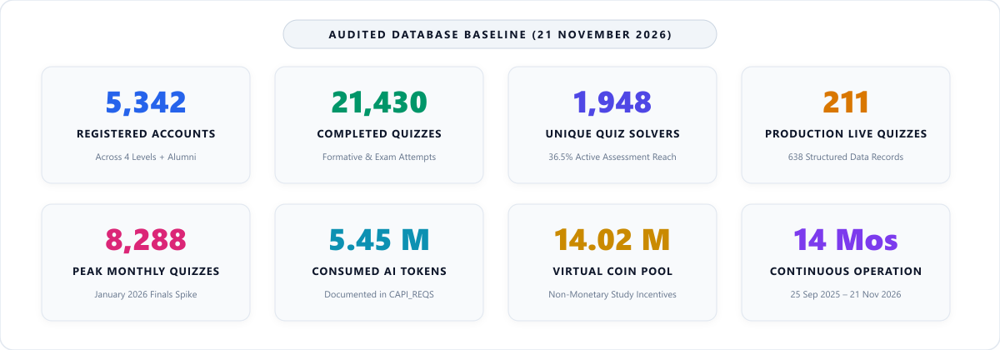
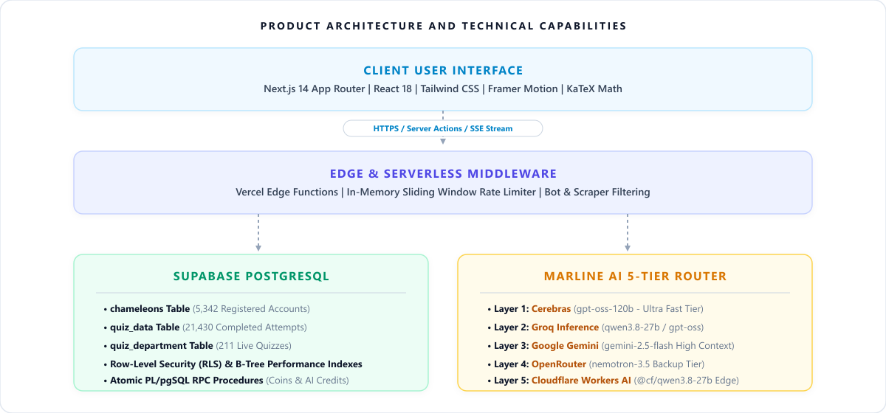
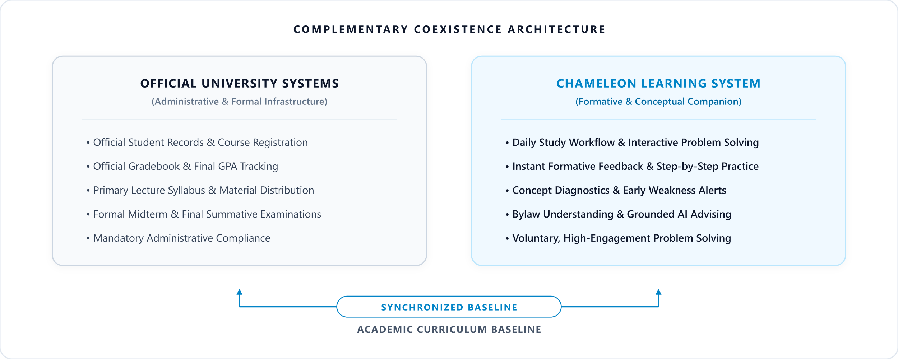
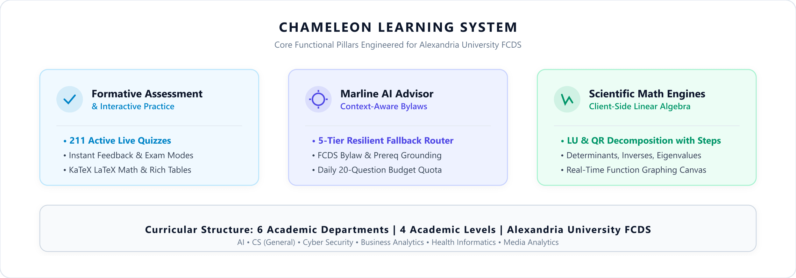

# CHAMELEON PLATFORM — EXECUTIVE INSTITUTIONAL READINESS REPORT

**Document Type:** Institutional Technical & Operational Readiness Assessment  
**Target Institution:** Faculty of Computer and Data Science (FCDS), Alexandria University  
**Audience:** Faculty Dean, Vice Deans, Department Heads, and IT Steering Committee  
**Baseline Date:** 21 November 2026  
**Operational Record:** 14 Months Continuous Production (25 September 2025 – 21 November 2026)  
**Inspection Scope:** Production PostgreSQL Records, Next.js Codebase, API Gateways, and Telemetry Logs  

---

## 1. Executive Summary

Chameleon is an educational companion and formative assessment web platform engineered specifically for the undergraduate degree programs and credit-hour bylaws of the Faculty of Computer and Data Science (FCDS) at Alexandria University. 

Operating continuously in production for **14 months** (since 25 September 2025), the platform delivers curriculum-aligned formative assessments, a credit-hour bylaw advisor (Marline AI), and client-side computational engines.

### Audited Core Metrics (21 November 2026 Baseline):
- **5,342 Registered Accounts:** Documented in `chameleons` table across 4 undergraduate cohorts and alumni.
  - Freshmen (Level 1): **864 (16.2%)**
  - Returning Students (Levels 2–4): **4,247 (79.5%)** *(Sophomores: 1,673; Juniors: 1,669; Seniors: 905)*
  - Alumni / Teaching Assistants / Unassigned: **231 (4.3%)**
- **21,430 Completed Quiz Attempts:** Documented in `quiz_data` across **211 live quizzes**.
- **1,948 Unique Quiz Solvers:** Representing an active formative participation reach of **36.5%** of all accounts.
- **Academic Examination Surges:** Activity sharply tracks exam periods, peaking at **8,288 quiz completions in January 2026 (Finals)**, **5,497 in November 2025 (Midterms)**, and **531 in November 2026**.
- **5.45 Million AI Tokens Consumed:** Logged across a 5-tier fallback architecture grounded in FCDS course bylaws.
- **Lean Operating Cost:** Current base infrastructure runs at **$46.25 to $61.25 / month (~2,300 to 3,000 EGP)**.

---

## 2. Platform Architecture & Capabilities

Chameleon operates on a serverless, event-driven web architecture designed for low latency and zero maintenance overhead:

### Core Technical Subsystems:
1. **Client Interface:** Next.js 14 (App Router), React 18, Tailwind CSS, Material Design 3 design system, Framer Motion, and KaTeX mathematics rendering.
2. **Edge Middleware:** Vercel Edge compute with in-memory sliding-window request throttling and bot filtering.
3. **Database Layer:** Supabase-managed PostgreSQL with Row-Level Security (RLS), composite B-tree performance indexes, and atomic PL/pgSQL stored procedures (`increment_user_coins`, `deduct_ai_credit`).
4. **AI Inference Router (Marline):** Dynamic multi-provider router coordinating 5 tiers (Cerebras `gpt-oss-120b` → Groq `qwen3.8-27b` → Google `gemini-2.5-flash` → OpenRouter → Cloudflare Workers AI) with health checking and SSE streaming.
5. **Bylaw Grounding Engine:** `bylaw-retriever.ts` maps queries to Alexandria University FCDS credit-hour regulations across **206 courses**, prerequisite trees, and bilingual aliases.
6. **Client-Side Math Engines:** `MathEngine.ts` (expression parser) and `MatrixEngine.ts` (LU/QR factorizations, determinants, eigenvalues) executing entirely in-browser.

---

## 3. Scope & Complementary Institutional Positioning

Chameleon is designed to **complement**, not replace or compete with, official university infrastructure:

| Dimension | Official University LMS & SIS | Chameleon Learning Companion |
|---|---|---|
| **Role & Purpose** | Mandatory administrative records, course registration, official gradebooks. | Voluntary formative practice, self-paced diagnostic assessment, study aid. |
| **Assessment Type** | High-stakes summative evaluations (Midterm and Final exams). | Low-stakes formative exercises with instant step-by-step rationales. |
| **Academic Advising** | Scheduled physical faculty office hours. | 24/7 prerequisite and bylaw navigation assistance. |
| **Faculty Benefit** | Official records repository. | Early diagnostic heatmaps of student concept misunderstandings. |
| **Tooling** | Standard file repository. | Integrated scientific matrix calculators and practice timers. |

---

## 4. Technical Audit & Security Findings

A systematic codebase and database inspection identified eight findings across severity levels:

| Severity | Finding | Impact | Required Remediation |
|---|---|---|---|
| **HIGH** | In-Memory Serverless Rate Limiting | Edge lambdas do not share memory; concurrent limits can be bypassed. | Migrate to distributed **Upstash Redis** (`@upstash/ratelimit`). |
| **HIGH** | Dual Credential Storage | Dual verification via `chameleons.pass` and Supabase Auth. | Centralize identity under university SSO; deprecate legacy column. |
| **HIGH** | Synthetic Dashboard Graphs | Visual admin curves use `Math.sin` simulations if data is sparse. | Enforce direct SQL aggregations on `quiz_data` exclusively. |
| **MEDIUM** | Permissive Build Flags | `ignoreBuildErrors: true` present in `next.config.js`. | Enforce strict zero-warning CI gate for TypeScript and ESLint. |
| **MEDIUM** | Commercial Ad CSP Directives | CSP allowed external ad networks. | Restrict CSP to institutional and verified AI endpoints only. |
| **MEDIUM** | Supabase Egress Surges | Unpaginated fetches risk bandwidth spikes during finals. | Enforce indexed cursor pagination on all historical queries. |
| **LOW** | Orphaned File Utilities | Dead extraction helpers in `src/lib/file-processor.ts`. | Clean up unused utility files from repository. |
| **LOW** | Contributor Drive OAuth Tokens | Drive sync relies on personal contributor tokens. | Transition to an institutional Google Workspace Service Account. |

---

## 5. Operational Financial Reality

| Category | Monthly Cost (USD) | Monthly Cost (EGP) | Description |
|---|---|---|---|
| **Current Base Infrastructure** | **$46.25 – $61.25** | **~2,300 – 3,000 EGP** | Supabase Pro ($25) + Vercel Pro ($20) + Domain ($1.25) + Dev AI credits. |
| **Enhanced Pilot Infrastructure** | **$100.00 – $150.00** | **~4,900 – 7,350 EGP** | Base stack + Upstash Redis ($15) + Commercial AI ($40) + Sentry ($15). |
| **Optional Engineering Stipend** | *$250.00 – $350.00* | *~12,250 – 17,150 EGP* | *Optional student engineer maintenance honorarium (administrative).* |

---

## 6. Proposed Spring 2027 Academic Pilot (15 Weeks)

To establish verified academic impact under full faculty supervision, a controlled 15-week pilot is proposed across four foundational courses:

### Pilot Foundation Courses:
1. **Linear Algebra** (`02-24-00101` - Level 1 Foundation)
2. **Programming I / II** (`02-24-00105` / `02-24-00110` - Level 1 Core)
3. **Data Structures & Algorithms** (`02-24-00108` - Level 1/2 Core)
4. **Database Systems** (`02-24-00202` - Level 2 Core)

### Phased Roadmap:
- **Weeks 1–2 (Technical & Content Review):** Deploy Upstash Redis rate limiting; course coordinators review and approve question sets.
- **Weeks 3–10 (Active Practice):** Students engage with voluntary weekly formative problem sets; bi-weekly difficulty diagnostic reports delivered to instructors.
- **Weeks 11–12 (Midterm Review):** Instructors review aggregate concept weakness alerts to guide revision lectures.
- **Weeks 13–14 (Final Exam Preparation):** Timed practice modules opened; student/faculty feedback surveys administered.
- **Week 15 (Evaluation & Report):** Joint evaluation presented to the Faculty Council.

### Key Performance Indicators:
- **Cohort Activation:** ≥ 50% of enrolled students completing ≥ 2 quizzes per month.
- **Monthly Practice Volume:** ≥ 1,500 completed formative quizzes per month across pilot subjects.
- **Diagnostic Reports:** 100% on-time delivery of bi-weekly instructor error-rate summaries.
- **Student Approval:** ≥ 75% positive evaluation on end-of-term usability surveys.

---

## 7. Data Governance & Institutional Safeguards

1. **Egyptian Data Protection Law No. 151 of 2020:** The Faculty acts as **Data Controller**; platform maintainers operate strictly as **Data Processors**.
2. **Data Ownership:** Alexandria University retains exclusive ownership of all student records, practice logs, and diagnostic metrics. Student data is never sold, monetized, or shared with advertisers.
3. **Intellectual Property:** Maintainers retain platform source code; Alexandria University receives an institutional, non-exclusive educational operating license.
4. **Advisory Boundary:** AI outputs are advisory only and cannot grant academic waivers, graduation approvals, or formal exemptions.

---

## 8. Strategic Recommendation & Next Steps

Rather than committing to heavy commercial contracts or spending 9–12 months and 600k–1M EGP on custom development, FCDS leadership is invited to adopt a measured **five-step partnership**:

1. **Step 1: Presentation & Technical Demo:** Review audited platform capabilities with faculty leadership.
2. **Step 2: Joint Review Committee:** Appoint 2 faculty members and 1 IT representative to review question banks and security configurations.
3. **Step 3: Limited Pilot Approval:** Authorize the voluntary, 4-course pilot for Spring 2027.
4. **Step 4: Formal Evaluation:** Review empirical engagement and academic feedback at semester end.
5. **Step 5: Institutional Integration:** Evaluate long-term university SSO integration and hosting support based on documented pilot outcomes.

**Recommendation:** Approve Step 1 and form an informal Joint Review Committee.
