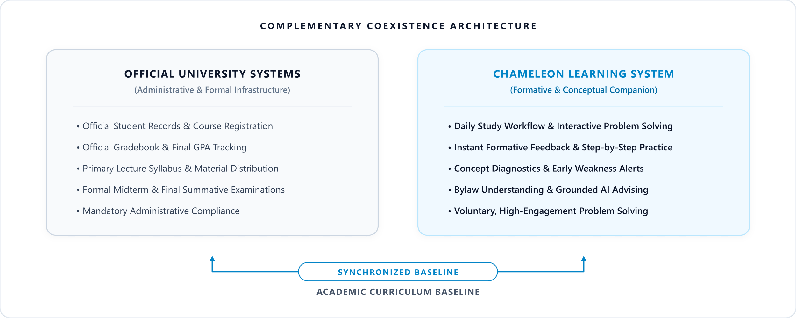
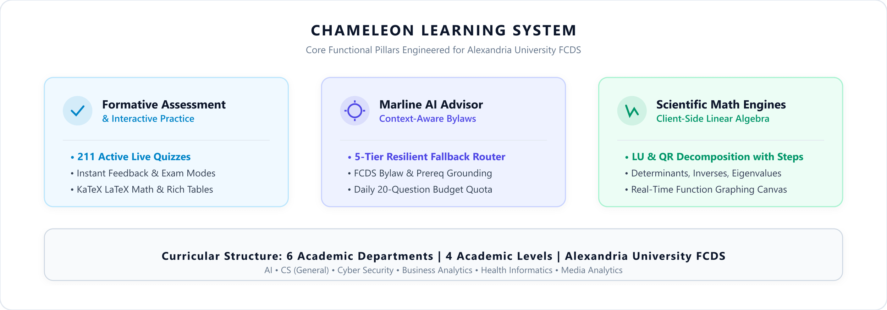
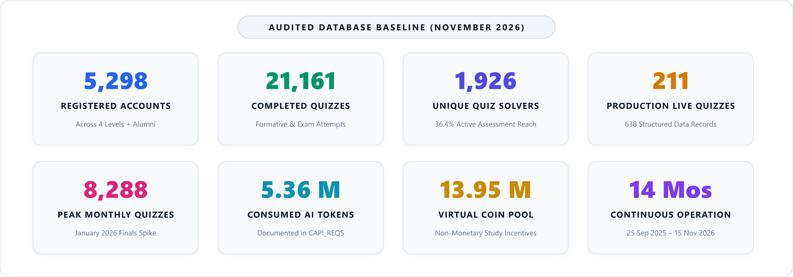
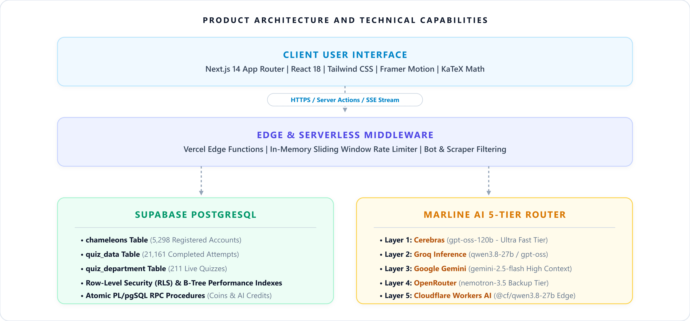
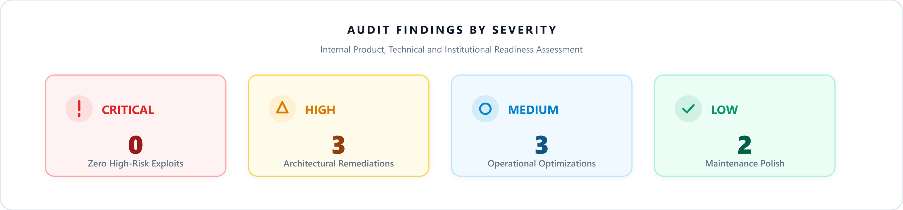

# CHAMELEON PLATFORM — INSTITUTIONAL PRESENTATION DECK
**Presentation Title:** Product Capabilities, Technical Due Diligence & Strategic Pilot Proposal  
**Nature of Document:** Internal Product, Technical and Institutional Readiness Assessment  
**Presented By:** Project Ownership & Technical Maintenance Team  
**Presented To:** Faculty Board & Leadership Council, Faculty of Computer and Data Science (FCDS), Alexandria University  
**Target Delivery:** 20 Minutes Presentation + 15 Minutes Discussion | 12 Slides  

---

## Slide 1: Title Slide & Context
- **Title:** CHAMELEON: Formative Assessment & Academic Companion for FCDS
- **Subtitle:** An Evidence-Based Internal Readiness Assessment & Phased Pilot Proposal
- **Presenter:** Project Ownership & Technical Maintenance Team
- **Audience:** Faculty Dean, Vice Deans, Department Heads, and IT / Academic Steering Committee
- **Key Message:** Presenting audited data from 14 months of operational history (25 September 2025 – 15 November 2026) and proposing a structured, low-risk academic pilot.

---

## Slide 2: The Student Learning Experience & Daily Study Friction
- **Header:** Navigating a Demanding Computer Science Curriculum
- **Core Observation:** FCDS students balance rigorous theoretical coursework with practical programming requirements:
  - Lecture notes and slides provide essential conceptual baselines.
  - However, students often lack structured, immediate self-testing tools between lectures.
  - Credit-hour bylaws, prerequisite trees, and elective rules can create confusion during course registration.
  - Students frequently turn to commercial chatbots that hallucinate Alexandria University bylaws and graduation rules.
- **The Opportunity:** Providing an integrated, faculty-aligned companion that offers immediate self-assessment, step-by-step problem rationales, and bylaw navigation.

---

## Slide 3: Complementary Value: Content Access vs. Formative Learning
- **Header:** Supporting the Educational Journey: Passive Delivery vs. Active Practice
- **Visual Flow:**
  ```
  [ University Distribution Systems ]        ──>        [ Chameleon Formative Companion ]
  • Official Syllabus & Announcements                   • Self-paced problem sets with instant feedback
  • Primary Course Material Distribution                • Step-by-step rationales & LaTeX formatting
  • Formal Summative Exams (Midterm/Final)              • Early self-diagnosis before high-stakes tests
  • Formal Academic Advising                            • 24/7 Context-aware bylaw navigation (Marline)
  ```
- **Takeaway:** Chameleon does not replace or compete with university portals; it complements them by activating student practice between lectures.



---

## Slide 4: Platform Overview: Built for Alexandria University FCDS
- **Header:** An Integrated Learning Ecosystem
- **Module 1 — Formative Assessment Engine:** 211 active quizzes in production; 638 pre-structured units with 16,948 questions in seed data covering 6 departments.
- **Module 2 — Marline AI Academic Advisor:** Curriculum-context-aware assistant using structured bylaw retrieval across a 5-tier fallback router.
- **Module 3 — Scientific & Matrix Engines:** Client-side LU/QR decomposition, determinants, inverses, and function graphing.
- **Module 4 — Virtual Motivation Economy:** Server-authoritative coin rewards for problem-solving; cosmetic profile badges and themes with zero fiat currency transactions.
- **Module 5 — Curricular Structure:** Fully mapped to Alexandria University FCDS department and course codes.



---

## Slide 5: Audited Database Evidence (Empirical Baseline)
- **Header:** 17 Months of Production Records (Audited 15 November 2026)
- **Verified Metrics from PostgreSQL Database:**
  - **5,298 Registered Accounts** in `chameleons` table since 25 September 2025.
  - **21,161 Completed Quiz Attempts** logged in `quiz_data`.
  - **1,926 Unique Student Solvers** confirmed via distinct `auth_id` query (**36.4% of total registered accounts**).
  - **3.1 Million AI Tokens** logged in `CAPI_REQS` under a daily 20-question quota.
- **Cohort Distribution Across Registered Accounts:**
  - Freshmen (Level 1): 681 (13.6%)
  - Sophomores (Level 2): 1,617 (32.3%)
  - Juniors (Level 3): 1,631 (32.5%)
  - Seniors (Level 4): 857 (17.1%)
  - Alumni / Teaching Assistants / Other: 227 (4.5%)
- **Important Disclosure:** Registered accounts reflect database entries; registrar cross-referencing is required to verify active enrolled student deduplication.



---

## Slide 6: Examination Seasonality & Student Engagement Patterns
- **Header:** Activity Strongly Correlated with the Academic Calendar
- **Monthly Quiz Completion Breakdown:**
  - **January 2026 (Final Exams Peak):** **8,288 quiz attempts**
  - **November 2025 (Midterm Exams Peak):** **5,497 quiz attempts**
  - **December 2025 (Pre-Final Review):** **4,001 quiz attempts**
  - **October 2025 / October 2026 (Semester Kickoff):** 603 / 571 attempts
  - **Recess / Break Months:** 1 to 80 attempts/month
- **Key Insight:** Student usage is intensely seasonal, surging during examination preparation windows. General web visits (DAU/MAU) are unmeasured by dedicated analytics tools.

---

## Slide 7: Marline AI: Bylaw-Context Retrieval & Boundaries
- **Header:** Curriculum-Context-Aware Academic Guidance
- **Design & Architecture:**
  - **Structured Bylaw Injection:** Pulls course titles, credit hours, and prerequisites from `faculty_courses_bylaw.json` for 206 courses.
  - **Multi-Provider Fallback:** 5-layer router (Cerebras -> Groq -> Google Gemini -> OpenRouter -> Cloudflare Workers AI) with automated cooldowns.
  - **Strict Quota Control:** 20 questions/day per student, logged and deducted atomically in the database.
- **Explicit Boundaries & Safeguards:**
  - While grounded in official rules, AI outputs are advisory and require human/student verification.
  - Clear user disclaimers: *"For formal academic petitions and graduation audits, always consult your official department advisor."*

---

## Slide 8: Technical Architecture & Security Hardening
- **Header:** Serverless Efficiency with Defined Remediation Priorities
- **Technical Strengths Verified:**
  - Next.js 14 App Router, Supabase PostgreSQL, and Google Drive API v3.
  - Composite B-tree indexes implemented in September 2026 on `quiz_data` and `Notifications`.
  - Server-authoritative validation for quiz submissions and coin minting.
- **Technical Remediation Required for Institutional Scaling:**
  - Migrate in-memory rate limiting (`src/lib/rate-limit.ts`) to distributed Upstash Redis to ensure multi-instance serverless protection.
  - Centralize authentication under university single sign-on (SSO).
  - Purge legacy advertising domains from the Content Security Policy (CSP).





---

## 9. Proposed Data Governance & Intellectual Property Model
- **Header:** A Structured, Collaborative Governance Framework
- **Data Protection & Compliance:**
  - Frame data processing under Egyptian Personal Data Protection Law No. 151 of 2020 via joint legal review.
  - **Data Ownership:** Alexandria University retains exclusive ownership of all student academic data, assessment scores, and system telemetry.
  - No commercial monetization, third-party data sharing, or advertising.
- **Intellectual Property Framework:**
  - Software code and platform branding remain the intellectual property of the founder/maintainers.
  - Propose granting Alexandria University FCDS a formal, non-exclusive institutional educational operating license.

---

## Slide 10: Financial Reality: Documented vs. Estimated Operating Costs
- **Header:** Transparent Operational Cost Classifications
- **1. Actual Documented Expenses (Current Baseline):**
  - Supabase Pro: \$25.00/mo | Vercel Pro: \$20.00/mo | Domain: ~\$1.25/mo
  - Current AI APIs: Developer / free tier promotional credits
  - **Total Documented Base Infrastructure:** **~\$46.25 to \$61.25 / month (~2,260 to 3,000 EGP / month)**
- **2. Estimated Future Operating Expenses for Institutional Pilot:**
  - Base Infrastructure + Distributed Redis (\$15/mo) + Dedicated Paid AI API Quota (\$40/mo) + Sentry (\$15/mo)
  - **Total Estimated Pilot Infrastructure:** **~\$100 to \$150 / month (~4,900 to 7,350 EGP / month)**
- **3. Proposed Engineering & Maintenance Stipend (Separate Classification):**
  - Optional student maintainer honorarium: ~\$250 to \$350 / month (~12,250 to 17,150 EGP).
  - *Strictly separated from hard infrastructure costs.*

---

## Slide 11: Proposed Spring 2027 Academic Pilot Plan
- **Header:** A Controlled, 15-Week Foundation Course Pilot
- **Scope: 4 Foundation & Core Courses:**
  1. *Linear Algebra* (`02-24-00101` - Level 1)
  2. *Programming I / II* (`02-24-00105` / `00110` - Level 1)
  3. *Data Structures & Algorithms* (`02-24-00108` - Level 1/2)
  4. *Database Systems* (`02-24-00202` - Level 2)
- **Target Pilot KPIs:**
  - ≥ 50% voluntary cohort participation in pilot courses.
  - ≥ 1,500 monthly quiz completions across pilot courses.
  - Bi-weekly concept difficulty reports delivered to course instructors.
  - ≥ 75% positive student feedback rating on end-of-term survey.
  - Comparative grade correlation proposed *conditionally* upon faculty authorization and privacy review.

---

## Slide 12: A Realistic, Phased Institutional Request
- **Header:** A Measured Path Forward
- **Step 1: Institutional Presentation & Dialogue:** Review findings with Faculty Leadership (Today).
- **Step 2: Joint Evaluation Committee:** Appoint a small ad-hoc committee (2 faculty members, 1 IT representative) to review question banks and architecture.
- **Step 3: Limited Pilot Approval:** Authorize a low-stakes, voluntary 4-course pilot for the Spring 2027 semester.
- **Step 4: Post-Pilot Evaluation:** Jointly review student feedback, system stability, and diagnostic utility at semester conclusion.
- **Step 5: Partnership & Support Discussion:** Explore formal recognition, long-term hosting sponsorship, and university SSO integration based on pilot success.
- **Thank you — Open for Questions and Discussion.**
